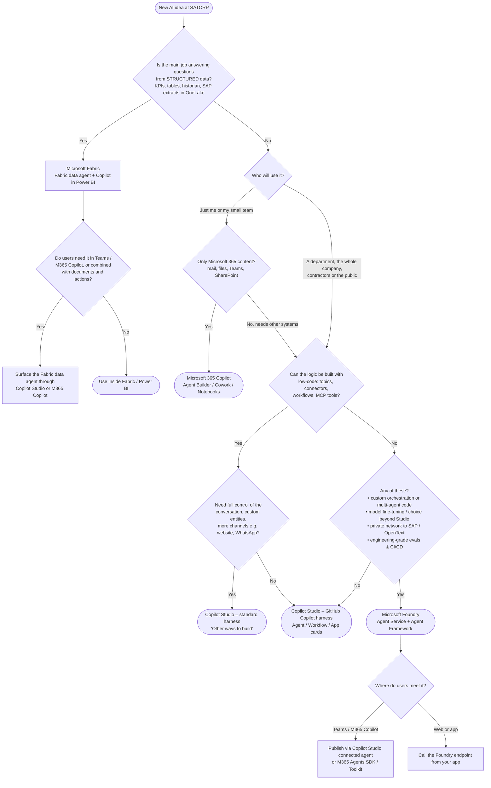
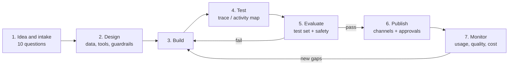
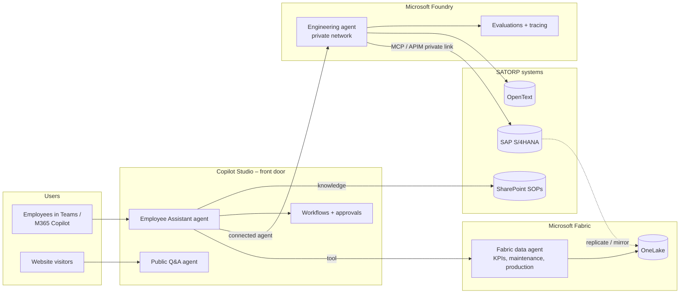
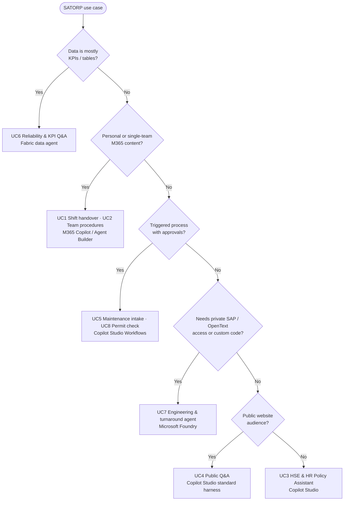

# Choosing the Right Microsoft AI Platform – Decision Guide for SATORP

### Microsoft 365 Copilot · Copilot Studio · Microsoft Foundry · Microsoft Fabric with Copilot

> **Audience:** SATORP business users, makers, IT, data and engineering teams
> 
> **Purpose:** decide **which platform to use**, **what tools, SDKs and skills** each needs, and **how to take an agent from build to publish to evaluation and monitoring**
> 
> **Status of facts:** checked against Microsoft documentation, October 2026. Several capabilities are in **preview**, as marked. Re-check before committing to a design.

---

## Table of Contents

1. [The 60-second answer](#1-the-60-second-answer)
2. [Master decision flowchart](#2-master-decision-flowchart)
3. [The four platforms at a glance](#3-the-four-platforms-at-a-glance)
4. [Ten questions that decide the platform](#4-ten-questions-that-decide-the-platform)
5. [Platform deep dives](#5-platform-deep-dives)
   - [5.1 Microsoft 365 Copilot](#51-microsoft-365-copilot--agent-builder-cowork-declarative-agents)
   - [5.2 Copilot Studio](#52-copilot-studio--low-code-agents-workflows-and-apps)
   - [5.3 Microsoft Foundry](#53-microsoft-foundry--pro-code-agents-and-models)
   - [5.4 Microsoft Fabric with Copilot](#54-microsoft-fabric-with-copilot--data-agents-and-analytics)
6. [Lifecycle: build → test → publish → evaluate → monitor](#6-lifecycle-build--test--publish--evaluate--monitor)
7. [Tools, SDKs and programming knowledge](#7-tools-sdks-and-programming-knowledge)
8. [How the platforms work together](#8-how-the-platforms-work-together)
9. [SATORP use-case portfolio](#9-satorp-use-case-portfolio)
10. [Governance, security and operations](#10-governance-security-and-operations)
11. [Anti-patterns – what not to do](#11-anti-patterns--what-not-to-do)
12. [Decision record template](#12-decision-record-template)
13. [Glossary](#13-glossary)
14. [References](#14-references)

---

## 1. The 60-second answer

| If you need… | Use | Who builds it |
| --- | --- | --- |
| A **personal or small-team assistant** over your own files, mail, Teams and SharePoint, with no integration | **Microsoft 365 Copilot**: Copilot Chat, **Agent Builder**, **Cowork** | Any employee with a Copilot license |
| A **department or company-wide agent** with defined conversations, connectors, workflows, approvals, Teams/web channels and analytics | **Copilot Studio** | Makers / citizen developers + IT |
| **Questions answered from structured plant or business data** (lakehouse, warehouse, Power BI, KQL) | **Fabric data agent** (+ Copilot in Fabric / Power BI) | Data engineers / analysts |
| A **custom, code-first agent**: own model choice, complex multi-agent logic, private networking to SAP or OpenText, strict engineering-grade evaluation | **Microsoft Foundry** (Agent Service + SDKs) | Professional developers |

**Rule of thumb:** start at the top of this table and **move down only when a requirement forces you to**. Each step down adds capability, and also cost, skills and operational responsibility.

---

## 2. Master decision flowchart



> 💡 **Read the chart top-down and stop at the first "yes" that satisfies the need.** Most SATORP ideas end at Microsoft 365 Copilot or Copilot Studio. Foundry is for the few cases that really need code.

---

## 3. The four platforms at a glance

| | **Microsoft 365 Copilot** | **Copilot Studio** | **Microsoft Foundry** | **Fabric with Copilot** |
| --- | --- | --- | --- | --- |
| **What it is** | AI assistant in Word, Excel, Outlook, Teams, plus Agent Builder, Cowork and Notebooks | Low-code platform for agents, workflows and apps | Azure platform for models, agents, evaluations and observability | Unified analytics with Copilot experiences and **data agents** |
| **Primary builder** | Business users | Makers, IT, power users | Professional developers, ML engineers | Data engineers, analysts |
| **Code needed** | None (pro-code optional via Agents Toolkit) | None to low (Power Fx, YAML optional) | **Yes**: Python or C# | SQL/DAX/KQL helpful; Python for SDK |
| **Grounding data** | Microsoft Graph: mail, files, chats, SharePoint, connectors | SharePoint, files, websites, Dataverse, connectors, MCP, Fabric data agents | Any: Azure AI Search, Blob, APIs, MCP, Fabric, SAP via your network | OneLake: lakehouse, warehouse, semantic models, KQL, mirrored DBs |
| **Actions / tools** | Limited (Cowork does tasks in M365; declarative agents can call APIs) | 1,000+ connectors, workflows, MCP, HTTP | Anything you can code: functions, OpenAPI, MCP, A2A | Read-only queries |
| **Channels** | M365 Copilot, Teams | Teams, M365 Copilot, websites, and more (standard harness) | Your app, API; Teams via SDK or Copilot Studio | Fabric/Power BI; Teams, M365 Copilot and Copilot Studio via integration |
| **Billing model** | Per-user Copilot license (Copilot Chat agents can be usage-billed) | **Copilot Credits** (prepaid or pay-as-you-go) | Azure consumption (models, compute, search, storage) | Fabric capacity (**F2 or higher** for data agents) |
| **Time to first value** | Minutes | Hours to days | Days to weeks | Days (if data is already in OneLake) |
| **Who runs it in production** | Microsoft (SaaS) | Microsoft (SaaS) + your admins | **You** (Azure resources, network, CI/CD) | Microsoft (SaaS) + your capacity admins |

---

## 4. Ten questions that decide the platform

Ask these in a 30-minute intake meeting **before** anyone starts building.

| # | Question | Points towards |
| --- | --- | --- |
| 1 | How many users: me, my team, a department, the company, external people? | Me/team → **M365 Copilot**; department and wider → **Copilot Studio** or **Foundry** |
| 2 | Is the answer in **documents** or in **tables**? | Documents → M365 Copilot / Copilot Studio; tables → **Fabric data agent** |
| 3 | Does the agent need to **do** something (create a work order, send an email, update SAP)? | Yes → **Copilot Studio** (connectors / workflows) or **Foundry** (code) |
| 4 | Does it have to reach systems on a **private network** (SAP S/4HANA, OpenText, plant systems)? | Yes → **Foundry** with private networking, or Copilot Studio with an on-premises data gateway / private MCP |
| 5 | Must the conversation follow **exact, auditable steps** (regulated data capture)? | Yes → **Copilot Studio standard harness** (topics, entities) |
| 6 | Do you need a **specific model**, fine-tuning or your own orchestration code? | Yes → **Foundry** |
| 7 | Who will **maintain** it after go-live? A business team or a dev team? | Business → M365 Copilot / Copilot Studio; dev team → **Foundry** |
| 8 | What **evaluation rigour** is required? A spot check, or automated test suites in CI/CD? | CI/CD-grade → **Foundry**; test sets in the portal → **Copilot Studio** |
| 9 | Which **channel**: Teams, M365 Copilot, public website, mobile app? | Website → Copilot Studio standard harness or Foundry; Teams/M365 → any |
| 10 | What are the **data residency**, classification and approval needs? | Confirm region and DLP for **every** platform; sensitive operational data → private Foundry or tightly scoped Copilot Studio |

---

## 5. Platform deep dives

### 5.1 Microsoft 365 Copilot – Agent Builder, Cowork, declarative agents

**Use it when**

- The user works mainly in **Outlook, Teams, Word, Excel, PowerPoint and SharePoint**
- The agent helps **one person or one team** with their own content
- You need it **today**, with no IT project

**Don't use it when**

- Many users need **consistent, governed answers** with analytics → Copilot Studio
- It must **write to business systems** or run multi-step approvals → Copilot Studio workflows
- The data lives outside Microsoft 365 → Copilot Studio, Fabric or Foundry

**The three ways to build**

| Option | What it is | Skill level | Typical SATORP use |
| --- | --- | --- | --- |
| **Copilot Chat + Notebooks** | Ask questions grounded in selected files, mails and meetings; keep a project notebook | None | Prepare a turnaround review from meeting notes and reports |
| **Agent Builder** (in Copilot, **New agent**) | Describe or configure an agent with instructions, knowledge (SharePoint, OneDrive, files, websites, email, Teams) and starter prompts | None | A team "Lab Procedures Helper" over the lab SharePoint site |
| **Cowork** (+ skills) | Delegates multi-step tasks: creates Word/Excel/PowerPoint files, drafts emails, schedules automations; custom **skills** (`SKILL.md`) teach it your way | None to low | Weekly production-meeting pack generated every Sunday |
| **Declarative agents (pro-code)** | Agent defined as a manifest (instructions, knowledge, actions via **API plugins / OpenAPI**) built in **Microsoft 365 Agents Toolkit** | JSON/YAML, OpenAPI; some TypeScript | A governed department agent that calls a SATORP REST API |

**Tools, SDKs, skills**

| Need | Tool |
| --- | --- |
| No-code build | Copilot app → **Agent Builder**, Cowork, Notebooks |
| Pro-code build | **VS Code + Microsoft 365 Agents Toolkit**; declarative agent manifest; OpenAPI for API plugins |
| Custom engine (own orchestrator) in Teams / M365 Copilot | **Microsoft 365 Agents SDK** (.NET, JavaScript, Python) |
| Programming knowledge | None for Agent Builder; JSON + REST/OpenAPI for declarative agents; C#/JS/Python for the Agents SDK |

**Build → monitor in brief**

1. **Build:** Agent Builder → Configure → instructions, knowledge, "Only use specified sources".
2. **Test:** the **Try it** panel; check citations.
3. **Publish:** **Share** with specific people or a group; org-wide distribution goes through the **Microsoft 365 admin center** (agent management / registry).
4. **Evaluate:** manual test prompts, team feedback. No built-in test-set runner, so if you need one, **move to Copilot Studio**.
5. **Monitor:** Microsoft 365 admin center usage reports, the Copilot Dashboard (Viva Insights), and Purview audit for prompts and responses.

---

### 5.2 Copilot Studio – low-code agents, workflows and apps

**Use it when**

- The agent serves a **department, the whole company or external users**
- You need **connectors** (SAP, ServiceNow, SharePoint, Dataverse, 1,000+ more), **workflows**, **human approvals** or **MCP tools**
- You need **Teams, M365 Copilot or website** channels, **analytics**, **evaluations** and admin governance
- The team has **makers**, not software developers

**Don't use it when**

- You need custom orchestration code, fine-tuned models or engineering CI/CD → Foundry
- The question is purely analytical over big tables → Fabric data agent (then surface it in Copilot Studio)

**Two harnesses – choose at creation (you can't switch later)**

| | **GitHub Copilot harness** (Home: **Agent**, **Workflow**, **App** cards) | **Standard harness** ("Other ways to build", classic) |
| --- | --- | --- |
| Authoring | Describe it; components panel: Instructions, Knowledge, Tools, **Skills**, Model, **Memory**, Connected agents | **Topics**, nodes, variables, **custom entities**, generative or classic orchestration |
| Conversation control | The model plans each turn; **Hooks** at lifecycle points | Exact designed paths, plus generative orchestration |
| Channels | Microsoft 365 / Teams, website | Wider set: Teams, M365, websites, SharePoint, WhatsApp, contact centre and more |
| Authentication | Entra ID, anonymous | Entra ID, anonymous, manual/custom |
| Best for | Internal copilots, reasoning with tools, quick builds | Customer- and public-facing bots, regulated data capture, specific channels |

**Building blocks**

| Block | Use for |
| --- | --- |
| **Knowledge** | SharePoint, files, public websites, Dataverse, Graph connectors, Fabric data agents |
| **Tools** | Connectors, **MCP servers**, workflows, HTTP, computer use (standard harness) |
| **Workflows** | Triggered automation with AI nodes: **Extract**, **Classify**, **Agent**, **Copilot** (preview), **Human review**, conditions, connectors |
| **Apps (preview)** | Natural-language generated full-stack apps on Dataverse / connectors |
| **Connected agents** | Delegate to other Copilot Studio, Foundry, A2A or M365 SDK agents |

**Tools, SDKs, skills**

| Need | Tool |
| --- | --- |
| Build | Copilot Studio web portal (copilotstudio.microsoft.com) |
| Data | Dataverse, Power Platform connectors, on-premises data gateway |
| Custom tools | **MCP server** (any language; Python/TypeScript SDKs), custom connector (OpenAPI) |
| ALM | **Solutions**, pipelines in Power Platform, Power Platform CLI (`pac`) |
| Programming knowledge | None to start; **Power Fx** (formulas), adaptive card JSON, REST/OpenAPI and basic Python or TypeScript for MCP servers |

**Build → monitor in brief**

1. **Build:** agent + knowledge + tools/topics; keep everything in a **solution**.
2. **Test:** **Preview / Test** pane with the **activity map / trace** (which topic, tool and source ran).
3. **Evaluate:** **Evaluate** tab: test sets (CSV import, your own conversations or AI-generated), similarity / quality / **content safety** test methods.
4. **Publish:** **Publish**, then channels: Teams + M365 Copilot (admin approval for org-wide), website embed, others.
5. **Monitor:** **Analytics / Monitor**: sessions, resolution, escalation, CSAT, unanswered questions, Copilot Credit usage. Power Platform admin center for capacity, DLP and environment governance.

---

### 5.3 Microsoft Foundry – pro-code agents and models

**Use it when**

- You need **full control**: your own orchestration, multi-agent patterns, model choice (OpenAI, open models and others in the Foundry catalogue), fine-tuning
- The agent must reach **private systems** (SAP S/4HANA, OpenText, plant data) through **VNet / private endpoints / ExpressRoute**
- You need **engineering-grade quality**: automated evaluations in **CI/CD**, red teaming, OpenTelemetry tracing
- The agent is part of a **product or app** your developers own

**Don't use it when**

- A maker could build it in Copilot Studio in a week. Foundry means you own the infrastructure, security patching, network and on-call.

**Core components**

| Component | What it does |
| --- | --- |
| **Foundry Agent Service** | Managed runtime for agents (Responses-API based), tools: **MCP**, Azure AI Search, Fabric data agents, OpenAPI, functions; **private networking** (BYO VNet) |
| **Hosted agents** (preview) | Run containerised agent code (e.g. Agent Framework, LangGraph) as a managed service |
| **Model catalogue** | Deploy and compare models; fine-tune where supported |
| **Evaluations** | Built-in evaluators (groundedness, relevance, task adherence, tool-call accuracy and more), cloud evaluations, synthetic datasets (preview), **AI Red Teaming** |
| **Observability** | OpenTelemetry tracing to **Application Insights**, **Agent Monitoring Dashboard**, continuous evaluation |
| **Guardrails** | Content filters / Prompt Shields, including indirect (document) attacks |

**Tools, SDKs, skills**

| Need | Tool / package |
| --- | --- |
| Project and agents SDK | **`azure-ai-projects`** (Python) / `Azure.AI.Projects` (.NET), with `azure-identity` |
| Agent orchestration framework | **Microsoft Agent Framework 1.0** (GA Apr 2026): `pip install agent-framework` · `dotnet add package Microsoft.Agents.AI`. It succeeds Semantic Kernel + AutoGen patterns; supports MCP, workflows and multi-agent orchestration |
| Alternatives | LangChain / LangGraph (supported orchestration options) |
| Evaluation | Foundry SDK evaluation APIs; `azd` agent evaluations (preview) |
| Infrastructure | **Bicep / Terraform**, Azure CLI, `azd`, GitHub Actions / Azure DevOps |
| Network and security | VNet, private endpoints, Private DNS, API Management, Entra ID, Key Vault |
| Programming knowledge | **Python or C#** (intermediate), REST, async programming, Git, CI/CD, Azure networking basics, prompt and evaluation design |

**Build → monitor in brief**

1. **Build:** Foundry project (standard setup with private networking for SATORP), deploy a model, define the agent (instructions + tools) in code, with everything in Git.
2. **Test:** Foundry playground + unit tests on tools; traces for every run.
3. **Evaluate:** evaluation datasets (real SATORP questions with expected answers), automated evaluators in the **pull-request pipeline**, red teaming before go-live.
4. **Publish:** expose via your app/API; for Teams/M365, connect through **Copilot Studio (connected agent)** or the **M365 Agents SDK**.
5. **Monitor:** Application Insights traces, the Agent Monitoring Dashboard, continuous evaluation on sampled live traffic, Azure Monitor alerts (error rate, latency, token cost).

---

### 5.4 Microsoft Fabric with Copilot – data agents and analytics

**Use it when**

- The question is **"how much, how many, which, trend"** over **structured data** in OneLake
- Data is (or can be) in a **lakehouse, warehouse, Power BI semantic model, KQL / Eventhouse or mirrored database**
- You want **governed, read-only** natural-language Q&A on top of curated data

**Don't use it when**

- The answer is in documents (PDFs, procedures) → Copilot Studio / Foundry knowledge
- The agent must **write** data or take actions → Copilot Studio or Foundry (data agents are read-only)

**Two Copilot experiences in Fabric**

| Experience | For whom | Example |
| --- | --- | --- |
| **Copilot in Fabric / Power BI** | Builders and report users: write SQL/DAX/KQL, build reports, summarise pages | "Create a report page of monthly unplanned downtime by unit" |
| **Fabric data agent** (GA) | End users through chat, or other agents as a tool | "Which three units had the most unplanned downtime last quarter?" |

**Key facts about data agents**

- Sources: warehouse, lakehouse, Power BI semantic model, KQL database, mirrored database, ontology, Microsoft Graph, with **up to five** sources per agent
- Capacity: **F2 or higher** (or Power BI Premium P1+ with Fabric enabled)
- Consumed from: **Copilot Studio**, **Microsoft Foundry**, **Teams** and **Microsoft 365 Copilot**
- Limits to plan for: read-only, no unstructured files, English only, results capped at 25 rows × 25 columns

**Tools, SDKs, skills**

| Need | Tool |
| --- | --- |
| Data preparation | Data Factory pipelines / Dataflow Gen2, mirroring, shortcuts (e.g. SAP data, PI historian exports into OneLake) |
| Modelling | Lakehouse / Warehouse (SQL), **Power BI semantic model** (DAX), Eventhouse (KQL) |
| Data agent | Fabric portal → **Data agent**: add sources, **agent instructions**, **data source instructions**, **example queries** |
| Programming knowledge | **SQL** essential; **DAX** and/or **KQL** depending on source; Python (notebooks) for data engineering and SDK-based evaluation |

**Build → monitor in brief**

1. **Build:** curate tables (clear names, descriptions, relationships), create the data agent, add instructions and **example queries** for tricky metrics (e.g. how "availability %" is defined at SATORP).
2. **Test:** ask the questions in the agent chat; inspect the **generated SQL/DAX/KQL**.
3. **Evaluate:** a ground-truth question set (question → expected number). Run it after every change to the model or instructions.
4. **Publish:** publish the data agent, then connect it to Copilot Studio / Foundry / Teams / M365 Copilot.
5. **Monitor:** Fabric **Capacity Metrics** app (CU consumption), workspace monitoring, Purview for data governance, user feedback.

---

## 6. Lifecycle: build → test → publish → evaluate → monitor



| Stage | **M365 Copilot** | **Copilot Studio** | **Foundry** | **Fabric data agent** |
| --- | --- | --- | --- | --- |
| **Build** | Agent Builder / Cowork / Agents Toolkit | Portal: agent, topics, tools, workflows, apps | Code (`azure-ai-projects`, Agent Framework) + IaC | Fabric portal: sources, instructions, example queries |
| **Test** | Try it panel | Test pane + **activity map/trace** | Playground, unit tests, **traces** | Chat + inspect generated queries |
| **Evaluate** | Manual prompts, peer review | **Evaluate** tab: test sets, quality and content-safety methods | **Evaluators** in CI/CD, cloud evals, **red teaming** | Ground-truth Q&A set (notebook / SDK) |
| **Publish** | Share; admin center for org-wide | Publish → Teams/M365 (admin approval), web, others; **solutions** for ALM | App/API; Copilot Studio connected agent or M365 Agents SDK for Teams | Publish; connect to Copilot Studio / Foundry / Teams |
| **Monitor** | Admin center reports, Copilot Dashboard, Purview audit | **Analytics/Monitor**: sessions, resolution, CSAT, credits; PPAC | **App Insights**, Agent Monitoring Dashboard, continuous eval, Azure Monitor | Capacity Metrics, workspace monitoring, Purview |
| **Owner** | User / team | Maker team + CoE | Dev team + platform team | Data team |

### Minimum quality gate before any SATORP agent goes live

- [ ] **20–50 real questions** with expected answers, written by the business owner
- [ ] **≥ 90 %** correct on that set; **0** answers outside approved sources on sensitive topics
- [ ] **Safety tests:** HSE emergencies redirect to emergency procedures; confidential questions (salaries, financials, security) are refused
- [ ] **Prompt-injection test** (instructions hidden in documents or emails)
- [ ] **Arabic and English** tests where the audience needs both
- [ ] **Named owner**, support contact and review date recorded
- [ ] **Monitoring** configured: who looks at the dashboard, how often, and what triggers action

---

## 7. Tools, SDKs and programming knowledge

### 7.1 Skills matrix by role

| Role | M365 Copilot | Copilot Studio | Foundry | Fabric data agent |
| --- | --- | --- | --- | --- |
| **Business user** (HSE, HR, finance, operations) | ✅ Build own agents | 🟡 Requirements, testing, content owner | ❌ | 🟡 Ask questions, validate numbers |
| **Maker / power user** | ✅ | ✅ Build & publish | 🟡 Prompt and eval design | 🟡 Instructions and example queries |
| **IT / Power Platform admin** | ✅ Governance | ✅ Environments, DLP, ALM | 🟡 Identity and network | 🟡 Capacity, workspace security |
| **Data engineer / analyst** | ✅ | 🟡 Connect data agents | 🟡 | ✅ Build & own |
| **Professional developer** | 🟡 Declarative agents / Agents SDK | 🟡 MCP servers, custom connectors | ✅ Build & own | 🟡 Data pipelines |

✅ primary · 🟡 contributes · ❌ not needed

### 7.2 Programming knowledge required

| Platform | None | Low | Medium | High |
| --- | --- | --- | --- | --- |
| M365 Copilot (Agent Builder, Cowork) | ✅ | | | |
| M365 declarative agents (Agents Toolkit) | | ✅ JSON, OpenAPI | | |
| M365 custom engine agents (Agents SDK) | | | ✅ C# / JS / Python | |
| Copilot Studio – agents, topics, workflows, apps | ✅ | ✅ Power Fx, adaptive cards | | |
| Copilot Studio – custom MCP server / connector | | | ✅ Python or TypeScript, REST | |
| Fabric data agent | | ✅ SQL | ✅ DAX / KQL | |
| Microsoft Foundry | | | | ✅ Python/C#, Azure, networking, CI/CD |

### 7.3 Toolchain checklist

| Category | Tools |
| --- | --- |
| **Portals** | m365.cloud.microsoft (Copilot, Agent Builder, Cowork) · copilotstudio.microsoft.com · ai.azure.com (Foundry) · app.fabric.microsoft.com |
| **Developer tools** | VS Code · Microsoft 365 Agents Toolkit · GitHub / Azure DevOps · Azure CLI · `azd` · Power Platform CLI (`pac`) · Bicep/Terraform |
| **SDKs** | `azure-ai-projects` · `azure-identity` · `agent-framework` / `Microsoft.Agents.AI` · Microsoft 365 Agents SDK · MCP Python/TypeScript SDK |
| **Testing** | Copilot Studio Evaluate · Foundry evaluations & AI Red Teaming · MCP Inspector · Agents Playground (M365) |
| **Monitoring** | Copilot Studio Analytics · Application Insights / Azure Monitor · Fabric Capacity Metrics · Microsoft 365 admin center · Purview audit |
| **Governance** | Entra ID · Power Platform admin center (DLP, environments) · Microsoft Purview (sensitivity labels, DLP, audit) · Azure Policy |

---

## 8. How the platforms work together

The platforms are **layers that combine**, not competitors. A common SATORP pattern:



| Pattern | How |
| --- | --- |
| **Copilot Studio as the front door** | One agent in Teams; delegates numbers to a **Fabric data agent** and deep engineering tasks to a **Foundry agent** |
| **Foundry agent in Teams** | Add as a **connected agent** in Copilot Studio, or publish with the **M365 Agents SDK** |
| **Fabric data agent everywhere** | Same governed data agent reused from Copilot Studio, Foundry and M365 Copilot: build once, govern once |
| **MCP as the integration standard** | Wrap SAP/OpenText/plant APIs as **MCP servers** once; reuse them from Copilot Studio and Foundry with different permissions per agent |
| **Personal productivity on top** | Employees use **M365 Copilot / Cowork** for their own work, and can @mention the published company agents |

---

## 9. SATORP use-case portfolio

> Example use cases for planning. Data sources and owners must be confirmed with SATORP business and IT teams.

### 9.1 Use cases mapped to platforms

| # | Use case | Users | Data | Platform | Why this platform |
| --- | --- | --- | --- | --- | --- |
| 1 | **Shift handover & meeting summariser** | Shift supervisors | Teams meetings, emails, handover notes | **M365 Copilot** (Copilot Chat, Notebooks, Cowork) | Personal productivity over M365 content, no integration |
| 2 | **Team procedures helper** (e.g. laboratory or one maintenance crew) | One team | That team's SharePoint library | **M365 Copilot Agent Builder** | Small audience, documents only, built by the team itself |
| 3 | **HSE & HR Policy Assistant** (Arabic + English) | All employees and contractors in Teams | Approved SOPs, HR policies on SharePoint | **Copilot Studio** (standard or new harness) | Company-wide, governed answers, escalation, analytics, multilingual |
| 4 | **SATORP Public Q&A Assistant** | Website visitors, candidates | satorp.com public pages | **Copilot Studio – standard harness** | Public website channel, anonymous auth, designed menus and cards *(see the classic lab)* |
| 5 | **Maintenance request intake** | Planners, area engineers | Emails/forms → SAP PM notifications | **Copilot Studio Workflow** + agent + human review | Triggered process with Extract/Classify, approvals and connectors |
| 6 | **Reliability & production KPI Q&A** | Operations, reliability engineers, management | Equipment history, downtime, production KPIs in OneLake | **Fabric data agent** (+ Copilot in Power BI), surfaced in Copilot Studio | Structured numeric questions over governed data |
| 7 | **Engineering & turnaround planning agent** | Engineering, planning | SAP S/4HANA (private cloud), OpenText documents, P&IDs | **Microsoft Foundry** (private networking, APIM, MCP) | Private connectivity, complex reasoning, strict evaluation, dev-team owned *(see the Foundry + SAP guide)* |
| 8 | **Contractor permit & document check** | HSE, contract holders | Permits, certificates (PDF) | **Copilot Studio Workflow** (Extract node) → **Foundry** if volumes and accuracy need custom models | Start low-code, scale to pro-code only if needed |

### 9.2 Use-case decision flow for SATORP



### 9.3 Suggested roadmap

| Phase | Timeline | Use cases | Goal |
| --- | --- | --- | --- |
| **1 – Quick wins** | 0–3 months | UC1, UC2, UC4 | Adoption and trust; low risk |
| **2 – Governed enterprise agents** | 3–6 months | UC3, UC5, UC6 | Company-wide value; DLP, ALM, evaluation gates in place |
| **3 – Engineering-grade AI** | 6–12 months | UC7, UC8 (scaled) | Deep integration with SAP/OpenText through Foundry and private networking |

---

## 10. Governance, security and operations

| Area | M365 Copilot | Copilot Studio | Foundry | Fabric |
| --- | --- | --- | --- | --- |
| **Identity** | Entra ID (user context) | Entra ID / anonymous; agent and connector auth | Entra ID, managed identities, OAuth passthrough to tools | Entra ID; workspace and item permissions |
| **Data protection** | Purview labels honoured, audit | Power Platform **DLP** policies (connectors, MCP), environment security | VNet, private endpoints, Key Vault, APIM | OneLake security, Purview, sensitivity labels |
| **Responsible AI** | Microsoft-managed | Content moderation levels, evaluations, content-safety tests | Content filters, **Prompt Shields**, red teaming | Read-only, scoped sources |
| **ALM** | Admin-managed deployment | **Solutions** + pipelines across Dev/Test/Prod | Git + CI/CD + IaC | Deployment pipelines, Git integration |
| **Cost control** | Licenses, usage-billed Copilot Chat agents | Copilot Credits per environment | Azure budgets, quotas, token limits in APIM | Capacity sizing (F-SKU), Capacity Metrics |

**SATORP-specific checks**

- **Data residency:** confirm the region of each service and model deployment against SATORP and national requirements before onboarding confidential data.
- **Classification:** decide which data classes (public, internal, confidential, restricted) each platform may use. Restricted operational data belongs only in private-network Foundry or tightly controlled environments.
- **Agent register:** every published agent has an owner, purpose, data sources, audience, review date and evaluation score.
- **Centre of Excellence:** one small team reviews new agent requests with the 10 questions in section 4 and approves the platform choice.

---

## 11. Anti-patterns – what not to do

| ❌ Anti-pattern | ✅ Instead |
| --- | --- |
| Starting in Foundry "because it's more powerful" | Start at the simplest platform that meets the need (section 1) |
| Copying the same SOPs into five different agents | One governed knowledge source (SharePoint / Fabric), reused |
| A Fabric data agent over raw, unnamed tables | Curate tables, add descriptions and example queries first |
| Publishing without a test set | Apply the minimum quality gate (section 6) |
| Org-wide agents built in personal Agent Builder | Move to Copilot Studio with ALM, DLP and analytics |
| Direct database access from agents to SAP HANA | Go through SAP APIs (OData) / APIM / MCP with SAP authorisations |
| No owner after go-live | Named business + technical owner and a monthly review |

---

## 12. Decision record template

Copy this into each new use-case request.

```markdown
## Agent decision record – <Use case name>

| Item | Answer |
|---|---|
| Business owner | |
| Users (count / type) | |
| Main data (documents / tables / systems) | |
| Actions required (none / connectors / write to SAP …) | |
| Channel (Teams, M365 Copilot, website, app) | |
| Data classification | Public / Internal / Confidential / Restricted |
| Languages | English / Arabic |
| **Chosen platform** | M365 Copilot / Copilot Studio (harness) / Foundry / Fabric data agent |
| Why (reference the 10 questions) | |
| Rejected options and why | |
| Skills needed / build team | |
| Evaluation plan (test-set size, pass mark, safety tests) | |
| Monitoring owner and frequency | |
| Go-live approval | Name / date |
```

---

## 13. Glossary

| Term | Meaning |
| --- | --- |
| **Agent** | AI assistant with instructions, knowledge and tools that can answer and act |
| **Agent Builder** | No-code agent creator inside Microsoft 365 Copilot |
| **Cowork** | Microsoft 365 Copilot capability that carries out multi-step tasks and automations |
| **Declarative agent** | M365 Copilot agent defined by a manifest (instructions, knowledge, actions) |
| **Harness** | Copilot Studio's authoring and runtime framework: **standard** (classic) or **GitHub Copilot** (new) |
| **Topic** | A designed conversation path in the Copilot Studio standard harness |
| **Skill** | A reusable set of instructions (often a `SKILL.md`) that teaches an agent how to do a task |
| **MCP** | Model Context Protocol: open standard for agents to discover and call tools on a server |
| **Connected agent** | An agent that another agent can delegate to |
| **Fabric data agent** | Natural-language Q&A over OneLake data sources, reusable by other agents |
| **Foundry Agent Service** | Azure-managed runtime for pro-code agents |
| **Agent Framework** | Microsoft's open-source SDK (Python/.NET) for building agents and multi-agent workflows |
| **Evaluation** | Automated scoring of agent answers against expected results and safety criteria |
| **Tracing / observability** | Recording each step (model call, tool call, latency, tokens) of an agent run |
| **Copilot Credits** | Usage-based billing unit for Copilot Studio (and usage-billed agents) |

---

## 14. References

- [Agents powered by the GitHub Copilot harness – overview (Copilot Studio)](https://learn.microsoft.com/en-us/microsoft-copilot-studio/agents-experience/overview)
- [Add MCP tools to an agent (Copilot Studio)](https://learn.microsoft.com/microsoft-copilot-studio/mcp-add-components-to-agent)
- [Agent Builder – add knowledge (Microsoft 365 Copilot)](https://learn.microsoft.com/en-us/microsoft-365/copilot/extensibility/agent-builder-add-knowledge)
- [Get started with Cowork](https://support.microsoft.com/en-us/microsoft-365-copilot/get-started-with-cowork)
- [Microsoft 365 Agents SDK](https://learn.microsoft.com/microsoft-365/agents-sdk)
- [Foundry Agent Service – private networking](https://learn.microsoft.com/en-my/Azure/foundry/agents/how-to/virtual-networks)
- [Foundry Agent Service GA announcement (March 2026)](https://devblogs.microsoft.com/foundry/foundry-agent-service-ga/)
- [What's new in Microsoft Foundry](https://learn.microsoft.com/en-ie/Azure/foundry/whats-new-foundry)
- [Microsoft Agent Framework 1.0](https://devblogs.microsoft.com/agent-framework/microsoft-agent-framework-version-1-0/)
- [Fabric data agent – concepts](https://learn.microsoft.com/fabric/data-science/concept-data-agent)
- [Fabric data agent in Copilot Studio](https://learn.microsoft.com/en-us/fabric/data-science/data-agent-microsoft-copilot-studio)

*Prepared as a follow-up for SATORP teams. Product capabilities change frequently; preview features are subject to change.*
