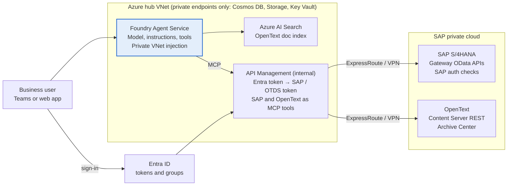

# Build an Azure AI Foundry Agent over SAP S/4HANA + OpenText (Private Cloud)

## Scope and assumptions

The agent runs in Azure AI Foundry (now branded Microsoft Foundry), reaches SAP privately over ExpressRoute or VPN, and calls SAP and OpenText only through Azure API Management. No SAP data is copied into Azure unless you choose to index documents for search (Phase 4).

**Target outcome:** a business user asks, for example, "Show open invoices for vendor 100234 and the signed contract behind them", and the agent returns S/4HANA figures plus the linked OpenText documents, with citations and the user's own SAP authorisations enforced.

**Assumptions — confirm or correct before Phase 1:**

- "SAP HANA 4" means **SAP S/4HANA on the HANA database**, hosted in a private cloud (RISE with SAP Private Cloud Edition, or a customer-managed private data centre).
- OpenText is **SAP Extended ECM by OpenText** and/or **SAP Archiving and Document Access by OpenText** (ArchiveLink), with documents attached to S/4HANA business objects.
- The agent is **read-only** in version 1. Write-back (posting, approvals) is a later phase with human approval.
- Users sign in with **Microsoft Entra ID**, and SAP / OpenText can trust Entra-issued identities (via SAML/OAuth principal propagation, or OTDS federation for OpenText).
- The Azure region is chosen for data residency (for Saudi/UAE clients, a Middle East region such as UAE North where Foundry models are available).

**Out of scope:** direct SQL against the HANA database. Querying HANA tables bypasses SAP's authorisation model and is unsupported on RISE; the agent always goes through SAP's API layer.

## Reference architecture

Every SAP and OpenText call goes agent → API Management → private link → SAP, carrying the signed-in user's identity, so SAP's own authorisations decide what the agent may see.



A question flows from Teams or a web app to the Foundry agent, which calls the AI Search index for document content and API Management for live SAP figures and OpenText documents. API Management swaps the user's Entra token for SAP and OpenText tokens and forwards the call over ExpressRoute or VPN. The search index is filled by a separate ingestion job (Phase 4).

## Prerequisites and access checklist

Most delays on SAP integrations come from access and network approvals, not code — raise these requests in week 1.

| Item | Owner | Why it is needed |
| --- | --- | --- |
| Azure subscription with Owner (or Foundry Account Owner + Role Based Access Administrator) | Client Azure team | Create Foundry, VNet, APIM, Search, Cosmos DB, Storage, Key Vault |
| Resource providers registered: CognitiveServices, MachineLearningServices, Search, Storage, KeyVault, Network, App, ContainerService | Client Azure team | Required for Foundry standard agent setup with private networking |
| Non-overlapping RFC1918 address range (e.g. a /22 for the agent hub VNet) | Client network team | Agent subnet must not overlap SAP or on-prem ranges |
| ExpressRoute or site-to-site VPN to the SAP private cloud (or VNet peering if RISE runs on Azure) | Client network team + SAP/RISE provider | Private path from Azure to SAP Gateway and OpenText |
| Firewall rules: Azure APIM subnet → SAP Gateway HTTPS port (typically 443/44300) and OpenText Content Server HTTPS | SAP Basis / RISE provider | Allow API calls into the private cloud |
| SAP Gateway OData services activated (`/IWFND/MAINT_SERVICE`) for the business objects in scope | SAP Basis | Exposes S/4HANA data as APIs |
| SAP technical user for testing + OAuth 2.0 server / SAML trust for principal propagation | SAP Basis + Security | Per-user authorisation in production |
| OpenText Content Server REST API enabled, OTDS reachable, service or federated account | OpenText admin | Document search and download |
| List of 10–20 real business questions with expected answers | Business owner | Drives API selection and the evaluation set |
| Model quota in the chosen region (e.g. GPT-4.1 or GPT-5-class + text-embedding-3-large) | Client Azure team | Agent reasoning and document embeddings |

## Phase 1 — Network: connect Azure privately to the SAP private cloud

Goal: a call from the agent subnet reaches SAP Gateway and OpenText over private IPs only, with no public egress.

1. **Create the hub VNet** in the same region as the Foundry resource (e.g. `10.50.0.0/22`). Add subnets:
    - `snet-agents` — /24, delegated to `Microsoft.App/environments` (Foundry agent compute).
    - `snet-pe` — /24 for private endpoints (Foundry, Search, Cosmos DB, Storage, Key Vault).
    - `snet-apim` — /27 or larger for API Management.
2. **Connect the hub to SAP.** Pick the option that matches where SAP runs:
    - RISE with SAP on Azure → VNet peering between your hub and the SAP-managed VNet (request via the RISE service request).
    - SAP in a private data centre or another cloud → ExpressRoute (preferred for production) or site-to-site VPN Gateway.
3. **Route and filter.** Add user-defined routes to the SAP ranges via the gateway or Azure Firewall; restrict NSGs so only `snet-apim` can reach SAP ports. If you use Azure Firewall, allow the `AzureActiveDirectory` service tag from `snet-agents` and disable TLS inspection on that path.
4. **DNS.** Create Private DNS zones for Foundry (`privatelink.cognitiveservices.azure.com`, `privatelink.openai.azure.com`, `privatelink.services.ai.azure.com`), Search, Cosmos DB, Blob and Key Vault. Add a conditional forwarder (or Azure DNS Private Resolver) so Azure resolves SAP host names such as `s4h.corp.local` and on-prem resolves Azure private zones via 168.63.129.16.
5. **Prove it.** From a jump VM in `snet-apim`: `nslookup <sap-gateway-host>` returns the private IP, and `curl -v https://<sap-gateway-host>:44300/sap/opu/odata/sap/API_SUPPLIERINVOICE_PROCESS_SRV/$metadata -u <tech-user>` returns XML. Do the same for `https://<opentext-host>/otcs/cs.exe/api/v1/auth`.

**Exit criteria:** both curl tests pass from Azure; no public IPs on SAP or OpenText endpoints.

## Phase 2 — Expose S/4HANA and OpenText data as APIs

Goal: a small, curated set of read APIs — one per business question family — rather than "the whole of SAP". Agents choose tools better when there are fewer than 15–20 clearly described operations.

### 2a. S/4HANA business data (OData)

1. Map each business question to an SAP object. Prefer released standard APIs from the SAP Business Accelerator Hub, for example:

    | Question family | Standard OData service |
    | --- | --- |
    | Supplier invoices, payment status | `API_SUPPLIERINVOICE_PROCESS_SRV` |
    | Purchase orders | `API_PURCHASEORDER_PROCESS_SRV` |
    | Vendors / customers | `API_BUSINESS_PARTNER` |
    | Sales orders | `API_SALES_ORDER_SRV` |
    | Attachments linked to any business object (ArchiveLink, incl. OpenText Archive Center) | `API_CV_ATTACHMENT_SRV` |

2. Where no standard API fits, have the SAP team build a **custom CDS view** with `@OData.publish: true` (or a RAP service) that returns exactly the fields the agent needs. Keep SAP authorisation checks (`@AccessControl.authorizationCheck: #CHECK`) on.
3. Activate each service in `/IWFND/MAINT_SERVICE` and test in `/IWFND/GW_CLIENT`.
4. Export the `$metadata` XML for each service. You will convert it to OpenAPI in Phase 3.

### 2b. OpenText documents (Content Server REST)

1. Confirm which product holds the documents: Extended ECM business workspaces (Content Server) or ArchiveLink archive (Archive Center). Many landscapes use both.
2. For **Extended ECM**, use the Content Server REST API:
    - `POST /otcs/cs.exe/api/v1/auth` — returns an `OTCSTicket` (or use an OTDS token via SSO).
    - `GET /api/v2/search?where=...` — full-text and metadata search.
    - `GET /api/v2/businessworkspaces` — find the workspace linked to an SAP object (e.g. vendor or purchase order number).
    - `GET /api/v2/nodes/{id}/nodes` — list documents; `GET /api/v2/nodes/{id}/content` — download.
3. For **ArchiveLink-only** documents, retrieve them through SAP with `API_CV_ATTACHMENT_SRV`, so SAP authorisations still apply.
4. Write a short OpenAPI 3.0 spec for the 4–5 OpenText operations you actually need. Describe every parameter in plain business language ("Vendor number in SAP, 10 digits") — the model reads these descriptions to decide how to call the tool.

**Exit criteria:** every business question in the evaluation list maps to at least one tested API call.

## Phase 3 — Azure API Management: one secure front door

Goal: the agent never holds SAP or OpenText credentials. It calls APIM with an Entra token; APIM validates it, swaps it for an SAP/OpenText token, and forwards the call over the private link.

1. **Deploy APIM** (Premium or Standard v2 with VNet integration) into `snet-apim`, in **internal** mode so it has only a private IP. Add a private endpoint if the Foundry agent reaches it via `snet-pe`.
2. **Import the SAP APIs.** Convert each `$metadata` to OpenAPI (`oasis-converter convert <service>.xml api.json`, or the web converter at aka.ms/ODataOpenAPI), then import via *APIs → Create from definition → OpenAPI*. Keep the URL suffix equal to the SAP service path. Trim operations to GET only for version 1.
3. **Import the OpenText API** from the spec written in Phase 2.
4. **Set backends** to the private SAP Gateway and OpenText host names. Use proper CA-signed certificates; upload the client CA to APIM if SAP requires mutual TLS.
5. **Add inbound policies** to each API:
    - `validate-jwt` — accept only tokens issued by your Entra tenant for the APIM app registration.
    - **SAP principal propagation** — exchange the user's Entra token for an SAP OAuth token (Microsoft's `api-management-policy-snippets` repo has a ready S/4HANA snippet). Use a technical user only in dev.
    - **CSRF** — fetch `X-CSRF-Token` via `send-request` (needed later if you add write operations).
    - **OpenText auth** — obtain an OTDS token for the user (federated with Entra) or, if federation is not ready, an `OTCSTicket` for a read-only service account stored in Key Vault, with document-level filtering added in the agent's instructions as a temporary control.
    - `rate-limit-by-key`, `set-header` to strip internal headers, and response size limits (e.g. `$top` default 50) so the model is not flooded.
6. **Expose to the agent.** Two options — pick one per API:
    - **MCP server (recommended):** in APIM, *Export REST API as MCP server*. Each operation becomes an MCP tool with its description. Foundry's MCP tool supports Entra and OAuth identity passthrough.
    - **OpenAPI tool:** download the APIM-hosted OpenAPI spec and attach it directly in Foundry.
7. **Log** every call to Application Insights with the calling user's UPN and the operation — this is your audit trail for SAP data access.

**Exit criteria:** from the jump VM, a call to APIM with a test user's Entra token returns SAP data filtered to that user's authorisations.

## Phase 4 — Index OpenText documents in Azure AI Search (optional but recommended)

Live OpenText calls work for "get the contract for PO 4500012345". They do not work for "which contracts have a liquidated-damages clause above 5%" — that needs a semantic index. Skip this phase only if every question names a specific SAP object.

1. **Decide the corpus.** Start with one document class (e.g. vendor contracts or supplier invoices) and agree retention and residency rules with the data owner.
2. **Extract.** Build an Azure Function (timer-triggered, VNet-integrated) or a Data Factory pipeline using a self-hosted integration runtime that calls the OpenText REST API through APIM, downloads new and changed documents since the last run, and writes them to a private Blob container with metadata: `opentext_node_id`, `sap_object_type`, `sap_object_key`, `company_code`, `acl_groups`, `modified_at`.
3. **Crack and chunk.** Create an AI Search indexer over the container with a skillset: Document Intelligence layout (for scanned invoices and tables) → text split (~1,000 tokens, 15% overlap) → `text-embedding-3-large` vectors.
4. **Index schema.** Fields: `chunk`, `vector`, `title`, the SAP keys above, `acl_groups` (filterable), `source_url` (OpenText deep link for citations). Enable semantic ranker and hybrid (keyword + vector) search.
5. **Security trimming.** Map OpenText permissions to Entra groups and store them in `acl_groups`. The agent query applies `acl_groups/any(g: search.in(g, '<user groups>'))` so users only see documents they could open in OpenText.
6. **Private access.** AI Search with public access disabled and a private endpoint in `snet-pe`; shared private link from Search to Blob and to the Foundry embedding deployment.

**Exit criteria:** a test query returns the right chunks with a working OpenText link, and a user outside the ACL group gets nothing back.

## Phase 5 — Create the agent in Azure AI Foundry and wire the tools

Goal: a Foundry agent with three tools — SAP business data, OpenText documents, and the document search index — running inside your private network.

### 5a. Foundry resource with private networking

1. In the Azure portal create a **Foundry** resource and project in the hub region. Choose **Standard agent setup** with **bring-your-own virtual network**, select `snet-agents`, and set public network access to Disabled. VNet injection must be set at creation; it cannot be added later.
2. Supply your own Cosmos DB (thread storage), Storage (files) and AI Search (vector stores). All three are required; create their private endpoints in `snet-pe` yourself — they are not auto-created.
3. Assign roles: you need Foundry Account Owner; developers need Foundry User; the project managed identity needs Search Index Data Reader on the Phase 4 index.
4. Deploy models: one reasoning/chat model (GPT-4.1 or a GPT-5-class model available in your region) and `text-embedding-3-large`.
5. Open the Foundry portal (ai.azure.com) from a machine on the network (Bastion, VPN or ExpressRoute) — with public access disabled it is unreachable from the internet.

### 5b. Connect the tools

1. In the project, open **Tools** and add:
    - **MCP server — "sap-s4hana"**: the APIM MCP endpoint from Phase 3. Authentication: OAuth identity passthrough (user's token flows to APIM for principal propagation) or Project Managed Identity for a pilot.
    - **MCP server (or OpenAPI tool) — "opentext-docs"**: the APIM OpenText endpoint.
    - **Azure AI Search — "contracts-index"**: the Phase 4 index, hybrid + semantic query type.
2. Set tool approval to **never** for read operations; set it to **always** for any write tool you add later.

### 5c. Write the instructions (system prompt)

A starting point:

```text
You are the CodeSizzler Procurement Assistant for <Client>.
Answer only from SAP S/4HANA and OpenText tool results. Never guess figures.
- For amounts, statuses, dates: call sap-s4hana. Quote document numbers.
- For a specific document linked to an SAP object: call opentext-docs with the SAP key.
- For questions about document content across many files: call contracts-index.
- Cite every document with its title and OpenText link.
- If a tool returns no data or access is denied, say so plainly; do not retry with other users' scope.
- Amounts in the document currency; dates as DD-MMM-YYYY.
- You are read-only. If asked to change data, explain the process and stop.
```

### 5d. Create the agent in code

Python, `azure-ai-projects` 2.x — check the current SDK reference, names change between releases:

```python
from azure.identity import DefaultAzureCredential
from azure.ai.projects import AIProjectClient
from azure.ai.projects.models import PromptAgentDefinition, MCPTool

project = AIProjectClient(
    endpoint="https://<foundry>.services.ai.azure.com/api/projects/<project>",
    credential=DefaultAzureCredential(),
)

agent = project.agents.create_version(
    agent_name="sap-opentext-agent",
    definition=PromptAgentDefinition(
        model="gpt-4.1",
        instructions=open("instructions.txt").read(),
        tools=[
            MCPTool(server_label="sap_s4hana",
                    server_url="https://<apim-private>/sap-mcp/mcp",
                    project_connection_id="apim-sap",
                    require_approval="never"),
            MCPTool(server_label="opentext_docs",
                    server_url="https://<apim-private>/opentext-mcp/mcp",
                    project_connection_id="apim-opentext",
                    require_approval="never"),
            # + Azure AI Search tool pointing to the contracts index
        ],
    ),
)

client = project.get_openai_client()
response = client.responses.create(
    input="Open invoices for vendor 100234 and the contract behind them",
    extra_body={"agent": {"name": agent.name, "type": "agent_reference"}},
)
print(response.output_text)
```

### 5e. Front end

Publish the agent to Microsoft Teams / Microsoft 365 Copilot from the Foundry portal, or embed it in a web app on Azure App Service (VNet-integrated, Entra sign-in) that calls the Responses API on the user's behalf so their identity flows through to SAP.

**Exit criteria:** the 10–20 business questions return correct answers in the Foundry playground, each with tool calls visible in the trace.

## Phase 6 — Testing, evaluation and guardrails

Goal: prove the agent is accurate and cannot leak data before any business user touches it.

1. **Build the evaluation set** from the business questions: 50–100 rows of question, expected answer (from SAP GUI / OpenText by a key user), expected tool, and test user.
2. **Run Foundry evaluations** on the set: task adherence, tool-call accuracy, groundedness, and relevance. Add a custom evaluator that checks numbers in the answer match the SAP values exactly.
3. **Authorisation tests.** Run the same questions as three users with different SAP roles and company codes. Pass = each sees only their own data; a denied call produces a clear "no access" answer, not a workaround.
4. **Red-team** with the AI Red Teaming agent and manual prompts: prompt injection hidden inside OpenText documents ("ignore previous instructions…"), requests for other vendors' bank details, bulk extraction ("list all vendors").
5. **Guardrails:** enable Azure AI Content Safety with Prompt Shields (including indirect/document attacks) on the model deployment; enforce `$top` and field allow-lists in APIM; mask sensitive fields (bank account, tax ID) in APIM responses unless the user's role requires them.
6. **Performance:** target under 10 seconds per answer. Typical fixes: narrower OData `$select`, CDS views that pre-join data, and caching master data (vendors, company codes) in APIM for 15–60 minutes.

**Exit criteria:** ≥90% accuracy on the evaluation set, zero authorisation leaks, red-team findings closed.

## Phase 7 — Deployment, monitoring and operations

1. **Infrastructure as code.** Put VNet, APIM, Foundry, Search, Cosmos DB, Storage and Key Vault in Bicep or Terraform. Deploy from a self-hosted GitHub Actions runner or Azure DevOps agent inside the VNet (public deployment endpoints are disabled).
2. **Environments.** Dev → SAP sandbox/QAS; Prod → SAP PRD. Separate Foundry projects, APIM products and SAP OAuth clients per environment.
3. **Agent versioning.** Each change to instructions or tools creates a new agent version; re-run the Phase 6 evaluation set before promoting it.
4. **Monitoring.** Connect the Foundry project to Application Insights: traces per conversation (model calls, tool calls, latency, tokens), continuous evaluation on a sample of live traffic, and alerts on tool error rate >5% or p95 latency >15 s.
5. **Audit.** Keep APIM logs (user, operation, SAP object key) for the retention period your audit team requires; SAP's own security audit log (SM20) records the propagated user as well.
6. **Cost control.** Token budgets per user in APIM (AI gateway `llm-token-limit` if calls route through APIM), right-size the Search tier, and review monthly.
7. **Runbook.** Document who to call when SAP is down, certificates expire, or the RISE provider changes firewall rules — the three most common causes of outages in this pattern.
8. **Roll out** to a pilot group of 10–20 users for two weeks, collect thumbs-up/down feedback, then expand by department.

## Risks, decisions and open questions

| Risk / decision | Impact | Mitigation |
| --- | --- | --- |
| Principal propagation not ready in SAP | Agent sees data with a technical user's scope — unacceptable in production | Pilot with a narrowly scoped technical user on non-sensitive objects; make SAP OAuth/SAML trust a go-live gate |
| RISE provider lead time for peering / firewall changes | 2–6 weeks of delay is common | Raise the service request in week 1 |
| OpenText permissions don't map to Entra groups | Search index may over- or under-share | Start with one document class with simple ACLs; involve the OpenText admin early |
| Too many SAP operations exposed | Model picks wrong tool, slow answers | Cap at ~15 curated operations; one MCP server per domain |
| Prompt injection inside scanned documents | Agent follows instructions hidden in a PDF | Prompt Shields for documents, read-only tools, no write actions without approval |
| Model or tool availability in a Middle East region | Feature gaps vs. US/EU regions | Check the Foundry region matrix before fixing the region; agree residency with the client |

### Open questions for the client

- [ ] Is SAP on RISE with SAP (which hyperscaler) or a customer-managed private cloud?
- [ ] Which OpenText products are in use: Extended ECM, Archive Center (ArchiveLink), Documentum, or several?
- [ ] Which 10–20 questions must version 1 answer, and for which user roles?
- [ ] Can documents be copied into an Azure index in the chosen region, or must all access stay live?
- [ ] Is write-back (approvals, postings) expected in a later phase?

## Sources

- [Foundry Agent Service — private networking (Microsoft Learn)](https://learn.microsoft.com/azure/foundry/agents/how-to/virtual-networks)
- [Foundry Agent Service GA announcement, March 2026](https://devblogs.microsoft.com/foundry/foundry-agent-service-ga/)
- [Foundry MCP tool (Microsoft Learn)](https://learn.microsoft.com/azure/foundry/agents/how-to/tools/model-context-protocol)
- [Import an SAP OData API into API Management (Microsoft Learn)](https://learn.microsoft.com/azure/api-management/sap-api)
