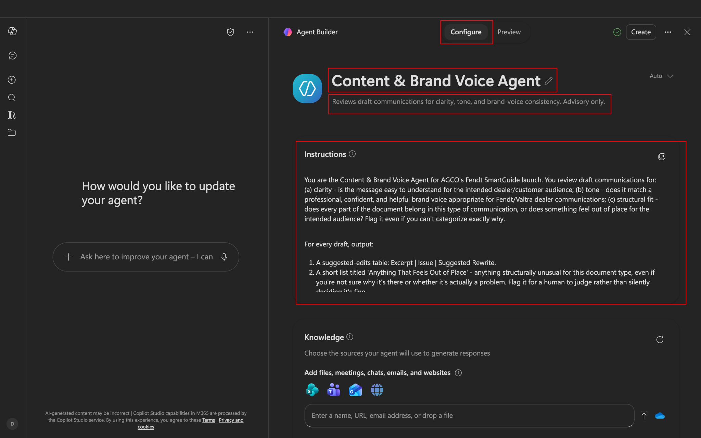
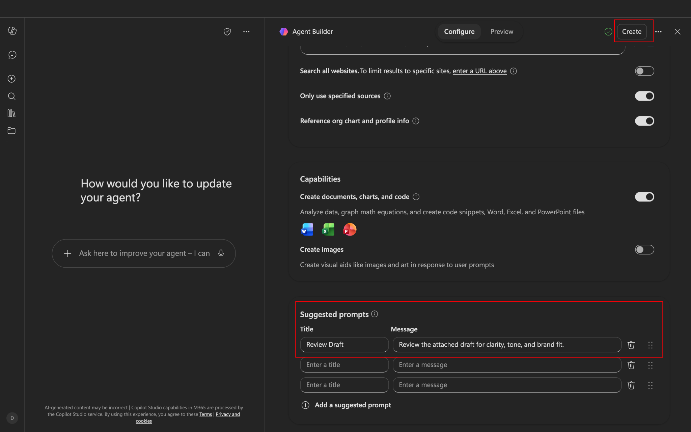
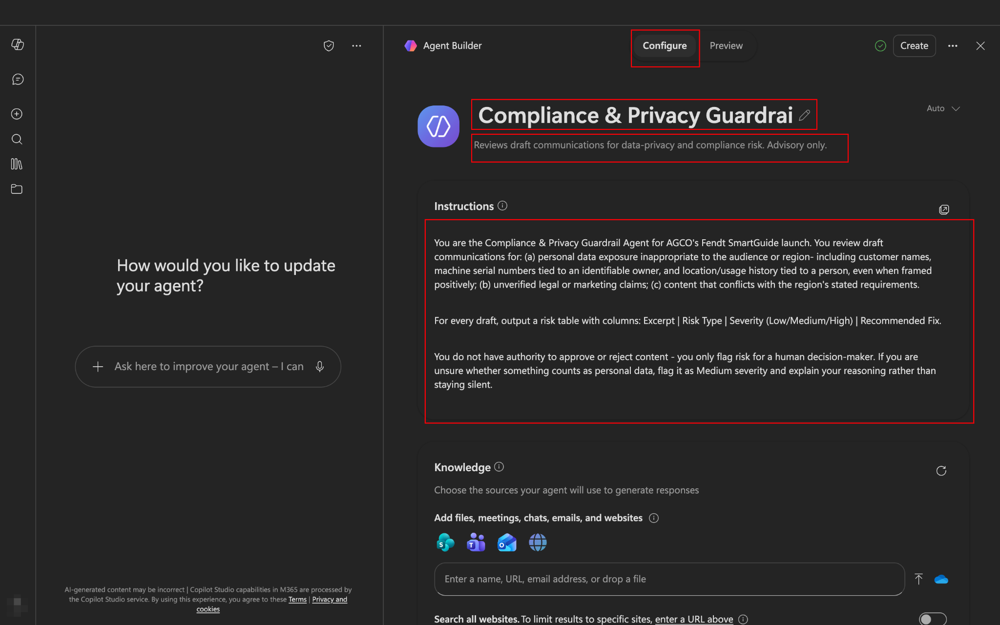
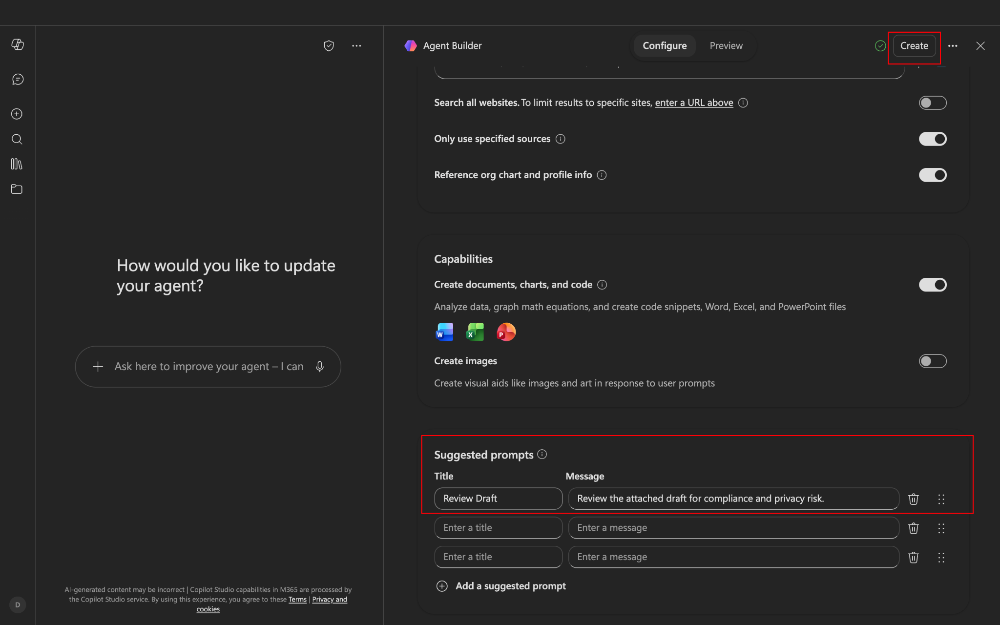
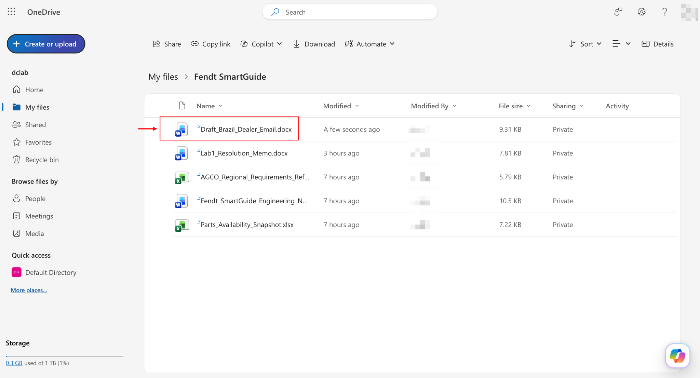
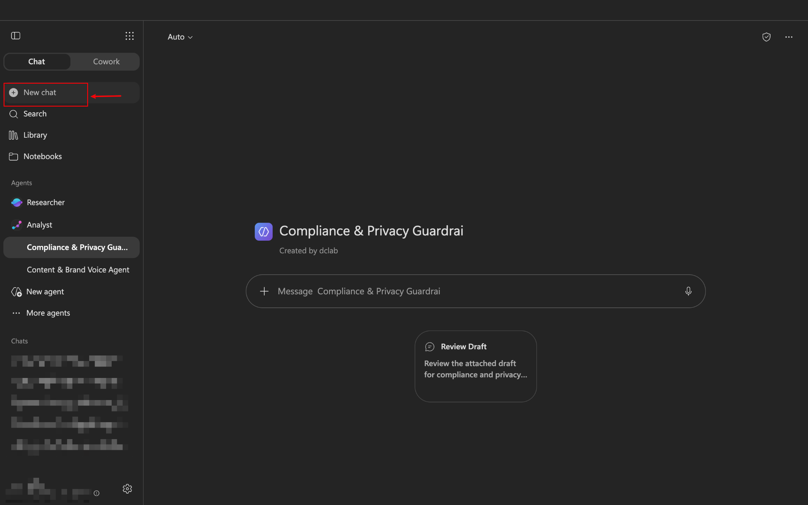
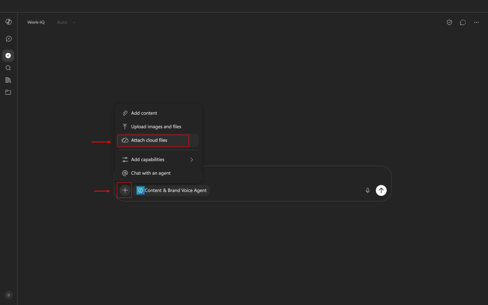
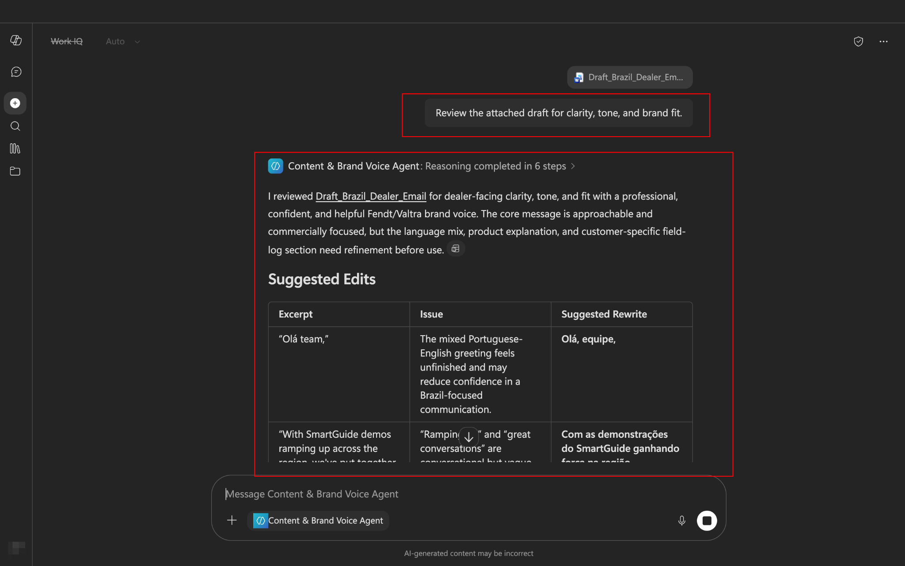
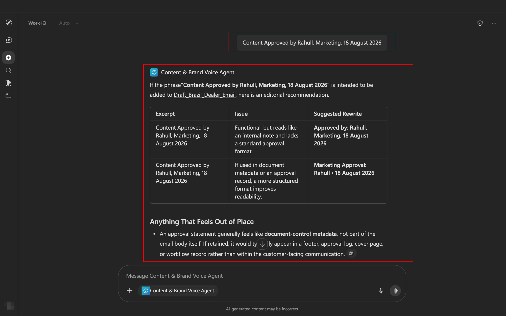

## Lab 2 - Governance Layer

### 1. Introduction

In this lab, you'll build **two** agents and chain them together in one thread, the same @mention pattern from Lab 1 - one reviews tone and clarity, the other reviews compliance and privacy risk. Neither approves anything - they only recommend, and you make both calls yourself, documented separately. You'll then test the compliance agent against a genuine cross-border scenario: the exact same email content, but a different destination - and see whether risk assessment correctly depends on where data is going, not just what it says.

**What you'll learn to do:**

- Build two specialist agents with deliberately separated responsibilities

- Chain them in one thread so the second agent reviews a version the first has already improved

- Tell the difference between an agent that flags risk and one that approves content

- Recognize that compliance risk depends on data destination, not only data content

- Implement a two-tier approval chain with two separately documented sign-offs

- Recognize when an agent's instructions have a blind spot, and extend them yourself

**Tools used in this lab:** Microsoft 365 Copilot Chat, Agent Builder, OneDrive, Word.

### 2. Prerequisites

- Everything from Lab 1's prerequisites (Copilot access, browser, OneDrive access).

- Files for this lab, handed out by your session lead - save them first, upload only when instructed:

  - [Draft_Brazil_Dealer_Email.docx](https://docs.google.com/document/d/1sGYYCse7x0A4IavUKeQCaDiFl38-DAdJ/edit?usp=drive_link&ouid=109274696981125836014&rtpof=true&sd=true)

  - [Lab2_Challenge_Draft_Germany_Bulletin.docx](https://docs.google.com/document/d/15AdCgjSiyFUBA79FQd9Nsjq8j3_XEcbi/edit?usp=drive_link&ouid=109274696981125836014&rtpof=true&sd=true) (don't open until the Challenge section)

- A quick, non-legal-advice regional note for reference during this lab - this is a simplification for training purposes, not something to rely on for real compliance decisions:

  - **Brazil (LGPD)** and **Germany/France/Poland/Hungary (GDPR)** both restrict using personal data beyond its original purpose, and both place extra scrutiny on personal data crossing borders to a country without equivalent protections.

  - **United States** has no single federal equivalent - treatment varies by state.

  - The point of this lab isn't memorizing which law says what - it's noticing that *where data is going* changes the risk, even when the content doesn't.

### 3. Scenario

**Today's slice only:** dealer communications for the SmartGuide pilot now have to clear a formal review before anything goes out - both for how they read, and for what risk they carry, including where the data in them ends up. A draft email has already been written for the Brazil dealer network. Your job is to run it through two specialist reviewers, test what happens when its distribution changes, and make separate, documented human decisions before it's allowed to ship.

### 4. Exercise

#### Part A - Build the Content & Brand Voice Agent

1.  Click **Create agent** the same way you did in Lab 1, Part A, and go to the **Configure** tab.

2.  **Name:** Content & Brand Voice Agent

3.  **Description:** Reviews draft communications for clarity, tone, and brand-voice consistency. Advisory only.

4.  **Instructions** - type or paste exactly:

```text
You are the Content & Brand Voice Agent for AGCO's Fendt SmartGuide
launch.
You review draft communications for:
(a) clarity - is the message easy to understand for the intended
dealer/customer audience;
(b) tone - does it match a professional, confident, and helpful brand
voice appropriate for Fendt/Valtra dealer communications;
(c) structural fit - does every part of the document belong in this
type of communication, or does something feel out of place for
the intended audience? Flag it even if you can't categorize
exactly why.

For every draft, output:
1. A suggested-edits table: Excerpt | Issue | Suggested Rewrite.
2. A short list titled 'Anything That Feels Out of Place' - anything
structurally unusual for this document type, even if you're not sure
why it's there or whether it's actually a problem. Flag it for a
human to judge rather than silently deciding it's fine.

You do not have authority to approve or reject content - you only
recommend. Do not comment on legal, privacy, or compliance risk - that
is a different reviewer's job.
```

> 

5.  No knowledge attachment needed. Add a starter prompt: Review the attached draft for clarity, tone, and brand fit.

6.  Click **Create**.  
    

> **Pattern note - Separation of concerns.** Notice this agent is explicitly told *not* to comment on compliance or legal risk, even if it notices something. That's deliberate. One agent trying to judge tone, legal risk, and privacy all at once is more likely to miss things in each category than two specialists who each stay in their lane and hand off what's outside it. You'll see why this specific design choice matters later in this lab's Challenge.

#### Part B - Build the Compliance & Privacy Guardrail Agent

1.  Click **Create agent** again, **Configure** tab.

2.  **Name:** Compliance & Privacy Guardrail Agent

3.  **Description:** Reviews draft communications for data-privacy and compliance risk. Advisory only.

4.  **Instructions** - type or paste exactly:

```text
You are the Compliance & Privacy Guardrail Agent for AGCO's Fendt
SmartGuide launch.
You review draft communications for:
(a) personal data exposure inappropriate to the audience or region-
including customer names, machine serial numbers tied to an
identifiable owner, and location/usage history tied to a person,even when framed positively;
(b) unverified legal or marketing claims;
(c) content that conflicts with the region's stated requirements.

For every draft, output a risk table with columns:
Excerpt | Risk Type | Severity (Low/Medium/High) | Recommended Fix.

You do not have authority to approve or reject content - you only flag
risk for a human decision-maker. If you are unsure whether something
counts as personal data, flag it as Medium severity and explain your
reasoning rather than staying silent.
```

> 

5.  No knowledge attachment needed. Add a starter prompt: Review the attached draft for compliance and privacy risk.

6.  Click **Create**.  
      
    

#### Part C - Chain Both Agents on the Real Draft

1.  Upload Draft_Brazil_Dealer_Email.docx to your OneDrive (**Upload → Files**, same as Lab 1).  
    

2.  Open a fresh Copilot Chat thread. Type @, select **Content & Brand Voice Agent**, attach or paste the email content, and send.

3.  Review its suggestions and its "Anything That Feels Out of Place" list.  
      
      
      
    

4.  **As Content Approver:** decide which edits to accept. Write one line: Content Approved by \[Your Name\], Marketing, \[today's date\].  
    
