## Lab 1 - Launch Coordination

### 1. Introduction

In this lab, you will build two AI agents inside Microsoft 365 Copilot that work together - one that extracts a clean specification from messy engineering notes, and one that turns that spec into a region-ready dealer brief. You'll chain them together in a single conversation using @mention, then turn their approved output into a real Word document and a real Excel checklist, without ever leaving Copilot Chat.

Along the way, you'll hit three patterns from the course outline in hands-on form, not just in theory: **structured outputs**, a simulated version of **ReAct-style tool/function calling**, and **human-orchestrated multi-agent chaining**. Each is called out at the moment it happens, so you can connect what you just did to the name for it.

**What you'll learn to do:**

- Create your first agent using Agent Builder ("Create an agent") in Microsoft 365 Copilot

- Write agent instructions that refuse to guess when data is missing or conflicting

- Chain two agents together in one thread with @mention

- Simulate a "function call" using a Human-as-API pattern

- Turn approved agent output into a real Word file and a real Excel file

**Duration:** approximately 105 minutes, including the closing challenge.

**Tools used in this lab:** Microsoft 365 Copilot Chat, Agent Builder, OneDrive, Word, Excel.

### 2. Prerequisites

Before you start, make sure you have:

- A working Microsoft 365 account with Copilot access, and you're able to sign in.

- A web browser (Chrome or Edge recommended).

- Access to your organization's OneDrive.

- The following files for this lab, which your session lead will hand out at the start - save them to your desktop or downloads folder first, you'll be told exactly when to upload each one:

  - [Fendt_SmartGuide_Engineering_Notes.docx](https://docs.google.com/document/d/1R9wkARcz6KAmalHcYY9EUppPZ3Cc34kO/edit?usp=drive_link&ouid=109274696981125836014&rtpof=true&sd=true)

  - [AGCO_Regional_Requirements_Reference.xlsx](https://docs.google.com/spreadsheets/d/1xbYUP6Vu_j4LfxxakaMSJlCoAegYqLt_/edit?usp=drive_link&ouid=109274696981125836014&rtpof=true&sd=true)

  - [Parts_Availability_Snapshot.xlsx](https://docs.google.com/spreadsheets/d/1FSNPJsPKO4c9ZVehNqljq64SvTxmYOnf/edit?usp=drive_link&ouid=109274696981125836014&rtpof=true&sd=true)

  - [Lab1_Resolution_Memo.docx](https://docs.google.com/document/d/1rtxKXa0SsQ2Cc3WBg5bGPQKD3q0l4Geg/edit?usp=drive_link&ouid=109274696981125836014&rtpof=true&sd=true)

  - [Lab1_Challenge_Mexico_Launch_Request.docx](https://docs.google.com/document/d/10cjjWFDJ-glixlMw7T1hIW8bwO0I4ydL/edit?usp=drive_link&ouid=109274696981125836014&rtpof=true&sd=true) (you won't need this until the Challenge at the end - don't open it yet)

You do not need any prior experience with Copilot, Agent Builder, or AI agents generally. Every click is spelled out below.

### 3. Scenario

#### 3.1 The full story - where today is headed

AGCO is preparing the pilot launch of **Fendt SmartGuide**, a new autonomous steering-assist feature for the Fendt 900 Vario series, rolling out first to Brazil, India, Germany, and the United States.

Here's the whole day, so you know where each lab sits in the arc:

- **Today, Lab 1:** the engineering spec has just landed - messy and partially unresolved. You'll turn it into dealer-ready material for two pilot regions.

- **Lab 2 (later):** that dealer material has to clear a formal compliance review before anything can go out.

- **Lab 3 (later):** partway through the day, pilot customers start reporting a field issue. You'll investigate it.

- **Lab 4 (later):** you'll run the full incident response and make a final leadership call on how AGCO responds.

#### 3.2 Today's slice - what Lab 1 actually solves

The SmartGuide engineering package has just arrived from PTx Engineering. It's a working draft, not a finished spec: it contains a conflicting torque measurement, an unfinished humidity test result, and a handful of open questions. Your job in Lab 1 is to turn this raw material into an approved, region-ready dealer brief for Brazil - while never letting an agent silently guess at something it doesn't actually know.

### 4. Lets Build

#### Part A - First-Time Navigation: Getting Into Agent Builder

1.  Open your web browser.

2.  Click the address bar, type microsoft365.com, and press Enter.  
    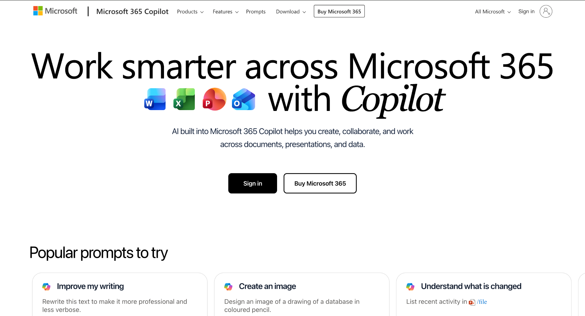

3.  If prompted, sign in with your work email and password.  
    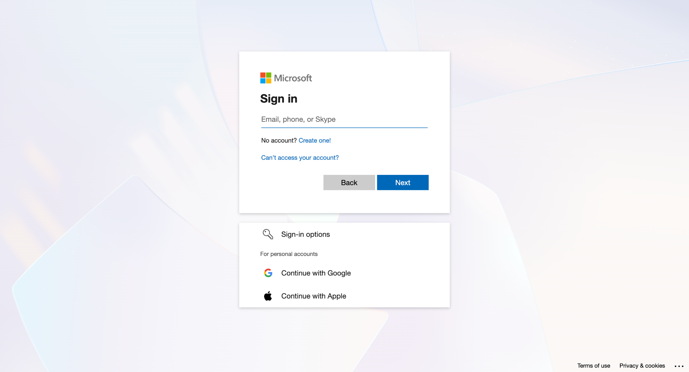

4.  Once the page loads, look at the left-hand sidebar. Find a button labeled **Create** or **Create agent** - it may show a small icon (often a "+" or a sparkle symbol) next to the word.  
    *  
    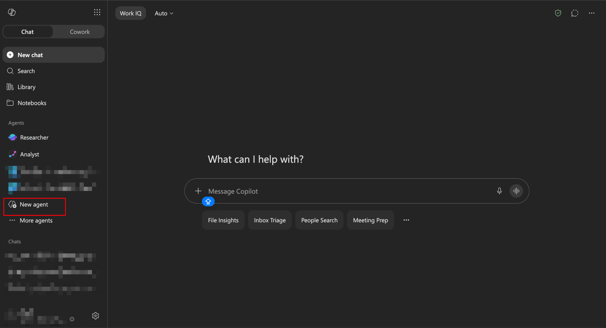  
    *

5.  Click it. A new screen opens, titled something like **New agent**, with two tabs near the top: **Configure and Preview**. *  
    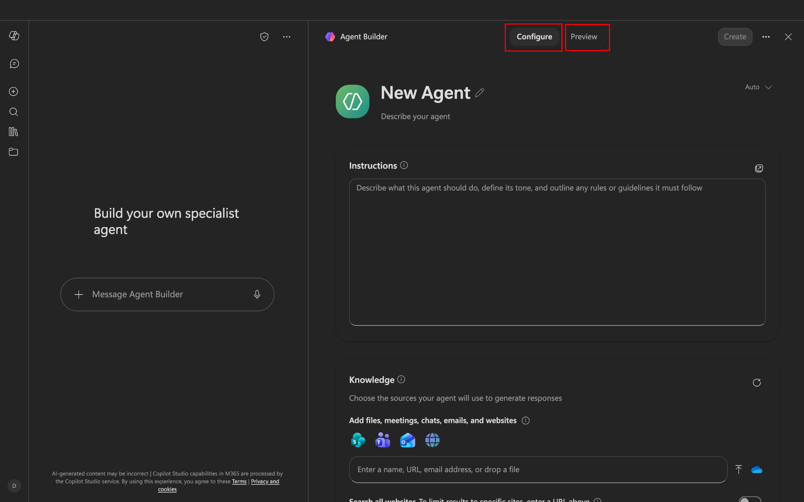  
    *

6.  Click the **Configure** tab. This gives you direct fields to fill in - Name, Description, Instructions, Knowledge, and Starter Prompts - rather than describing the agent in conversation.  
    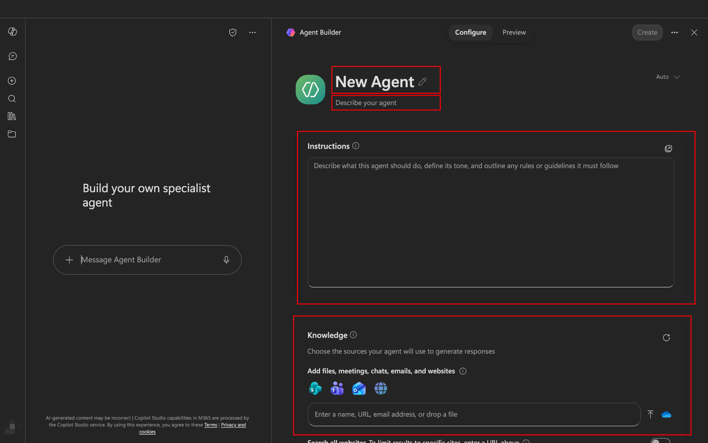  
      
    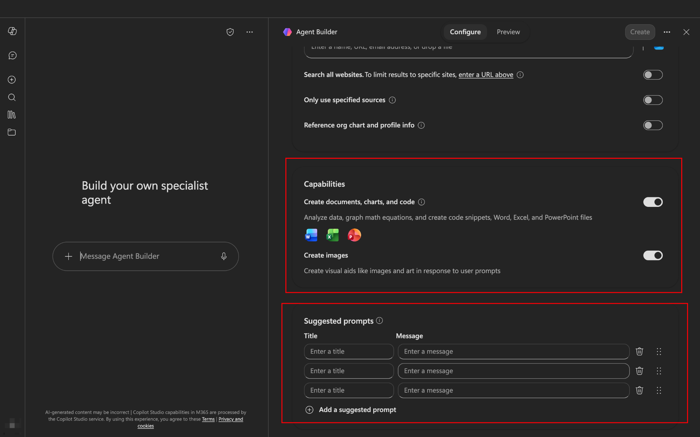

Keep this tab open - you'll use it again for the second agent later in this lab.

#### Part B - Build Agent 1: Spec Digest Agent

1.  In the **Name** field, type: Spec Digest Agent

2.  In the **Description** field, type: Extracts a structured spec from raw SmartGuide engineering notes and flags anything unclear.

3.  Find the **Instructions** field (it may be a large text box). Click into it and type or paste the following exactly:

```text
You are the Spec Digest Agent for AGCO's Fendt SmartGuide launch program.
Read the attached engineering notes and extract exactly these fields:
Feature Name, Steering Torque Range (Nm), Operating Humidity Range (%RH),
Operating Temperature Range (°C), Required Regional Certifications, Known
Open Issues.

Rules:
1. Only state a value that is explicitly written in the notes. Never
estimate, average, or infer a number that is not present.
2. If a field has two different values in the notes, or is marked
TBD/pending, do not choose one. Output 'NEEDS CLARIFICATION' and quote
both values found.
3. If a field is missing entirely, write 'NOT SPECIFIED'.
4. After the table, list every NEEDS CLARIFICATION / NOT SPECIFIED item
under an 'Open Questions' heading, in plain language a non-technical
reader can act on.
5. Do not add marketing language or opinions - this is factual extraction
only.
6. If you need data that is not in your knowledge (for example, current
parts stock), do not guess. Instead output a line in exactly this
format so a human can look it up for you:
LOOKUP_REQUEST: {"action": "...", "item": "...", "region": "..."}
```

> 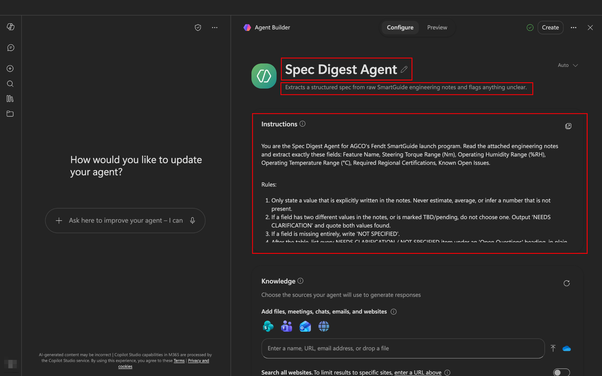

4.  Find the **Knowledge** section, below the Instructions field. There should be an option labeled **Attachments** (this may still show as "Uploaded Files" depending on when your tenant last updated). Click **Add** or **+**.

5.  A file picker opens. Click **Upload from this device** (or similar).  
      
    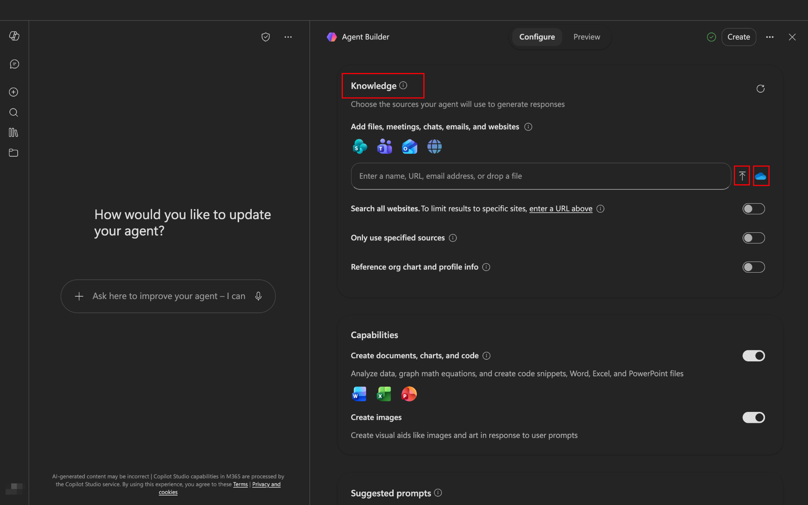

6.  **Now go get your file:** open a new browser tab, go to onedrive.com, sign in if prompted, click **Upload → Files** near the top, and select Fendt_SmartGuide_Engineering_Notes.docx from wherever you saved it. Wait for it to finish uploading to your OneDrive.  
    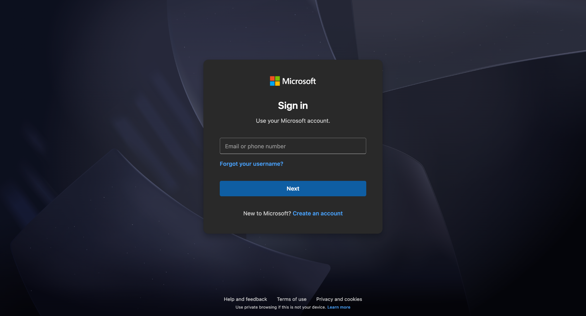  
      
    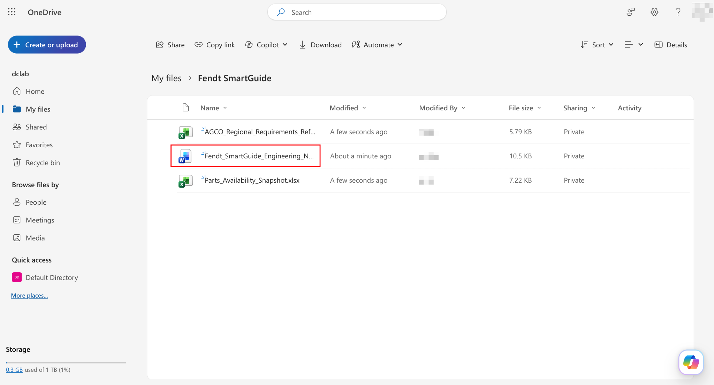

7.  Return to your Agent Builder tab, and in the file picker, select Fendt_SmartGuide_Engineering_Notes.docx from your OneDrive and attach it.  
    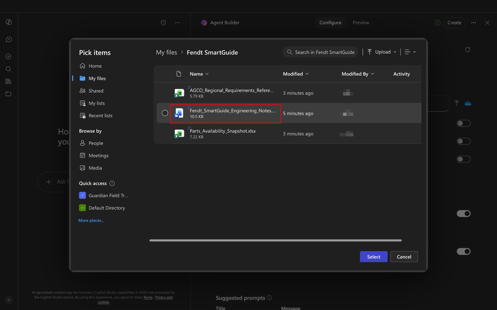  
    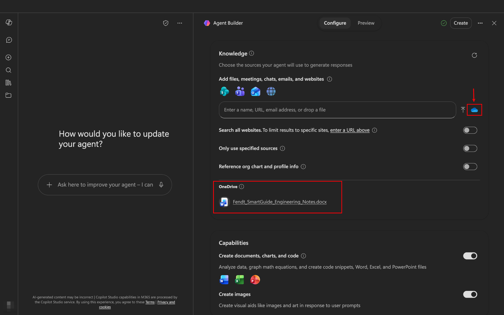

8.  Scroll to **Starter Prompts**. Add one that says:

> **Title:** Extract Structured Spec
>
> **Value:** Extract the structured spec from the attached engineering notes and flag anything unclear.

9.  Click **Create** (or **Save**, depending on your tenant's wording).  
    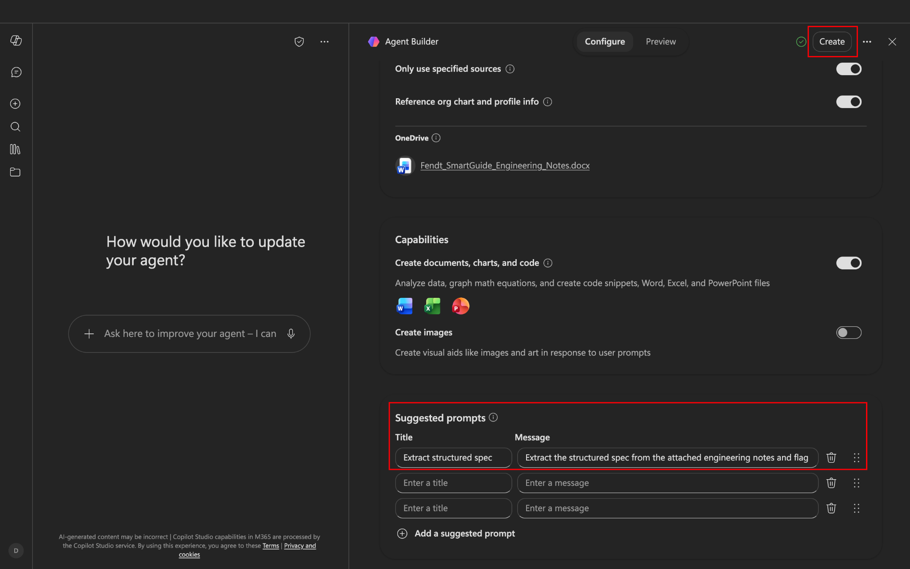

10. A test/preview pane should open on the right. Click your starter prompt to run it.  
      
    **Check your output:** confirm the agent's answer includes NEEDS CLARIFICATION for the steering torque field (quoting both 45–52 Nm and 38–44 Nm) and for the humidity field (marked TBD). If it picked one value instead of flagging both, revise your instructions (emphasize rule 2 more strongly) and run it again before moving on.  
    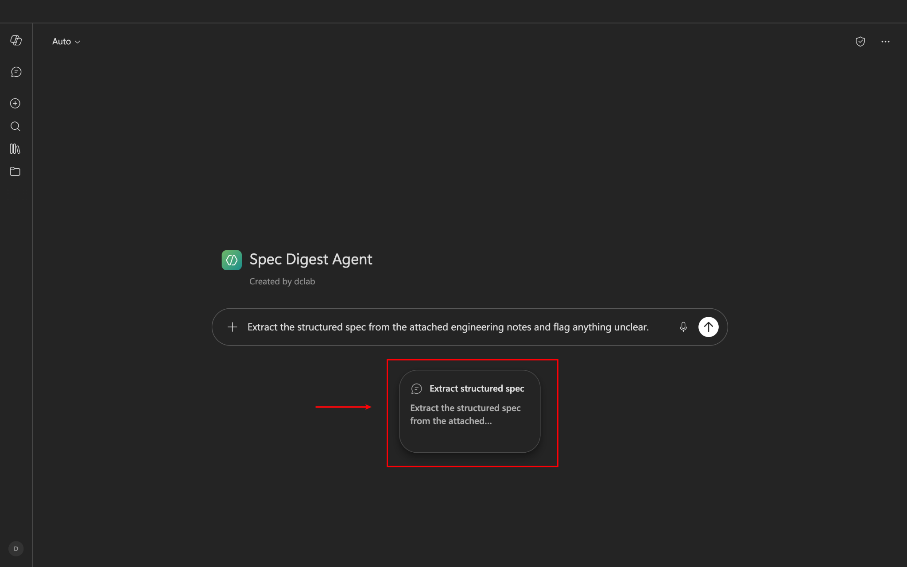  
    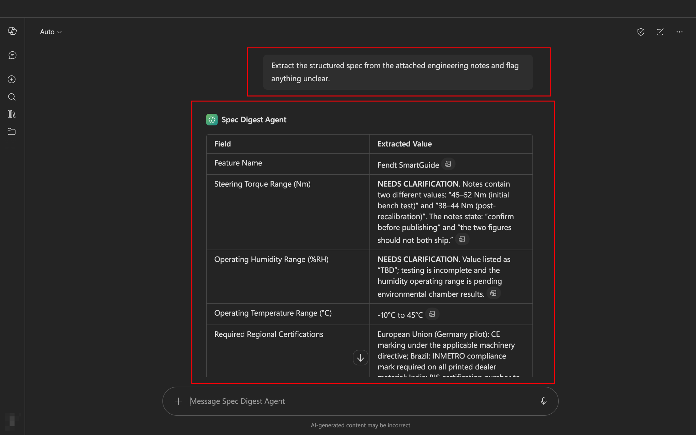

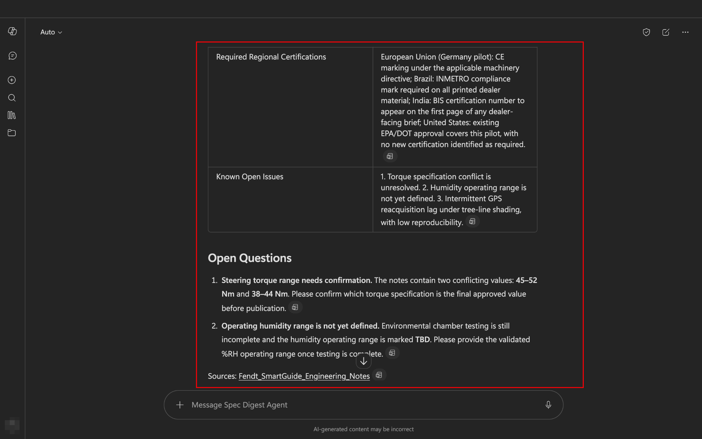

> **Pattern note -** Structured Output. What you just built is the outline's "Structured Outputs" pattern: a fixed set of fields plus explicit rules for what to do when data is missing or conflicting. The reason this matters beyond tidiness - a structured, rule-bound output is one where a mistake is checkable. A free-text paragraph could quietly pick 45 Nm and you might not notice; a table that's required to say NEEDS CLARIFICATION either says it or it doesn't. This same idea - a fixed, predictable shape for an agent's output - is also the foundation "Function Calling" depends on, which you'll meet in the next part.

#### Part C - Trigger the Human-as-API Pattern

1.  In the same chat with the Spec Digest Agent still active, type this message:

|                                                                                                  |
|--------------------------------------------------------------------------------------------------|
| Also check: do we have enough SmartGuide Sensor Kit stock in Brazil to support the pilot launch? |

2.  The agent should respond with a LOOKUP_REQUEST line rather than a guessed number, since parts stock isn't in its attached knowledge.  
    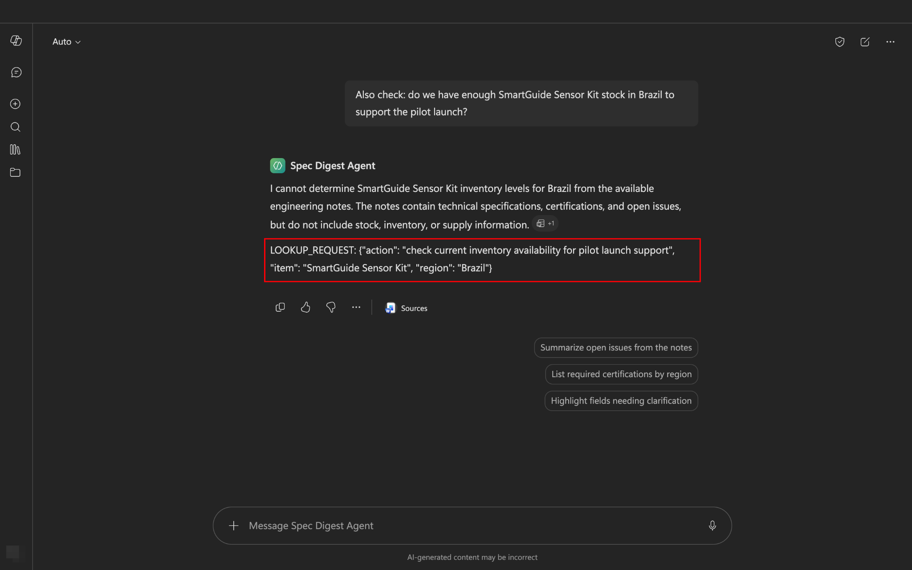

3.  Now you play the API. Open a new browser tab, go to onedrive.com, and upload Parts_Availability_Snapshot.xlsx (same upload steps as before: **Upload → Files**).  
    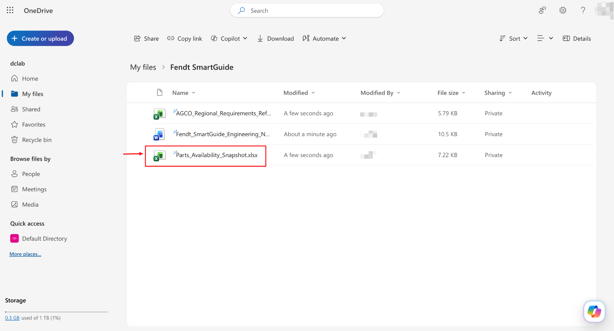

4.  Open the file from your OneDrive and find the row for **SmartGuide Sensor Kit, Brazil**. Note the **Units In Stock** value and whether the **Below Threshold?** column says OK or REORDER.  
    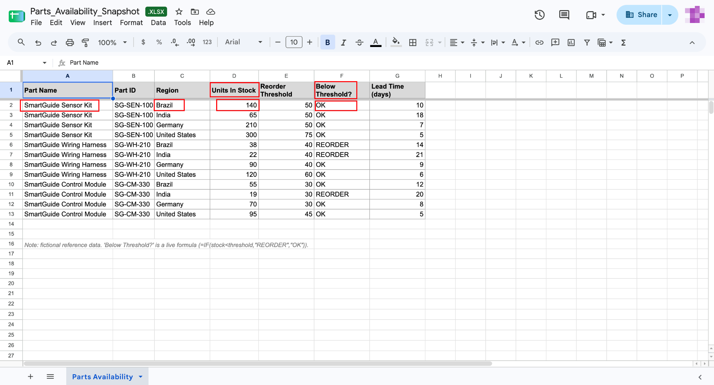

5.  Go back to your Copilot chat and type the answer back in, for example:

```text
Lookup result: SmartGuide Sensor Kit, Brazil = 140 units in stock,
status OK.
```

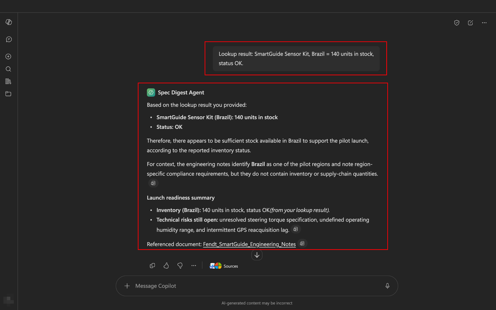

6.  Confirm the agent incorporates this into its next response rather than treating it as a new open question.

> **Pattern note - ReAct, in miniature.** You just hand-walked the loop the outline calls ReAct: the agent **Thought** it needed external data (it reasoned that parts stock wasn't something it could answer from its knowledge), took an **Action** (the LOOKUP_REQUEST), and received an **Observation** (the number you typed back), which it then reasoned over again. In a coded system, that Action would call a real API automatically instead of asking a person to go look something up - that's what "Function Calling" means, and what you just did by hand is standing in for it. The structured format from Part B is exactly what makes this loop possible: without a fixed shape for the request, there'd be nothing reliable for you (or a real API) to act on.

#### Part D - Resolve the Open Questions

1.  Upload Lab1_Resolution_Memo.docx to your OneDrive the same way as before.  
    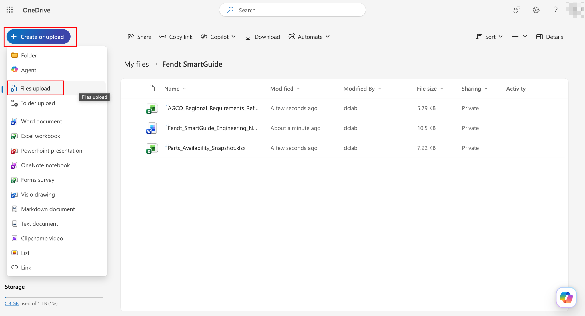  
    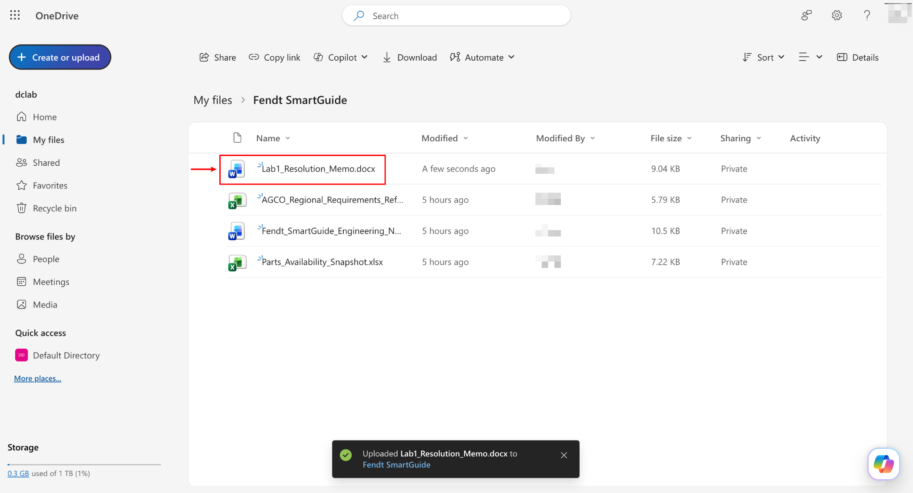

2.  Open it and read both clarifications (final torque value, and the validated humidity threshold).

3.  In your chat with the Spec Digest Agent, type the two corrected values in your own words, for example:

```text
Clarification received: final torque spec is 38-44 Nm. Humidity is
validated up to 85% RH; above 85% RH is not yet validated.
```

> 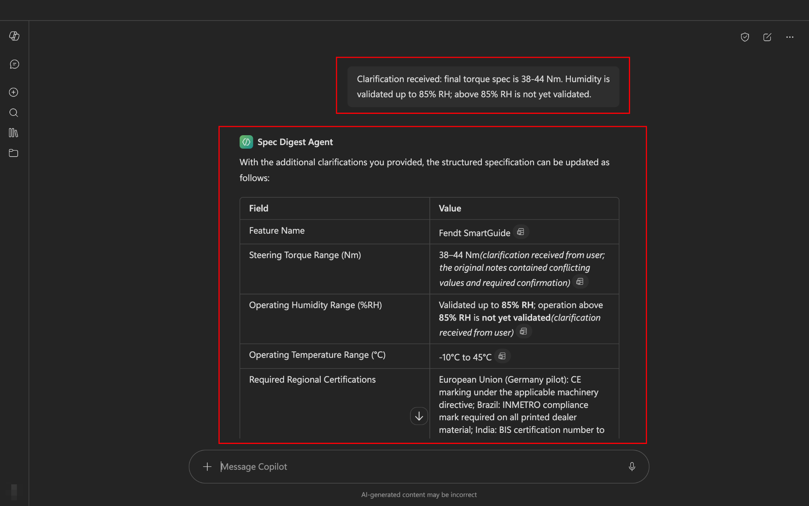  
> 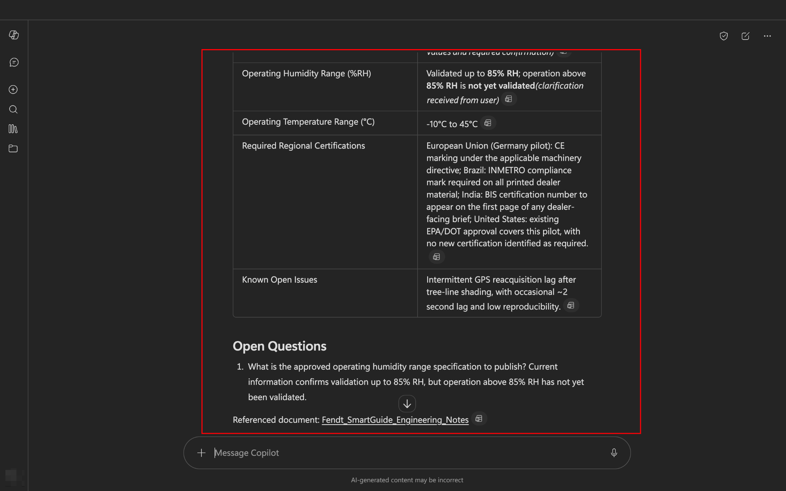

4.  Ask the agent to re-output the structured spec table with these corrections applied, and confirm it no longer shows NEEDS CLARIFICATION for those two fields.

|                                                                                                                                                                        |
|------------------------------------------------------------------------------------------------------------------------------------------------------------------------|
| Re-output the structured spec table with these corrections applied. Confirm that the steering torque and operating humidity fields no longer show NEEDS CLARIFICATION. |

> 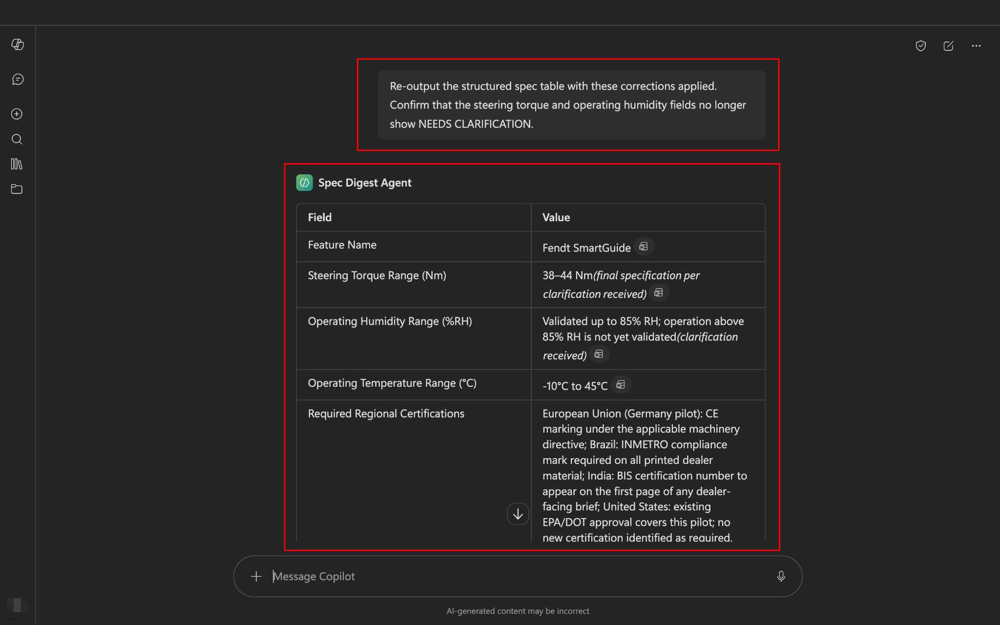  
> 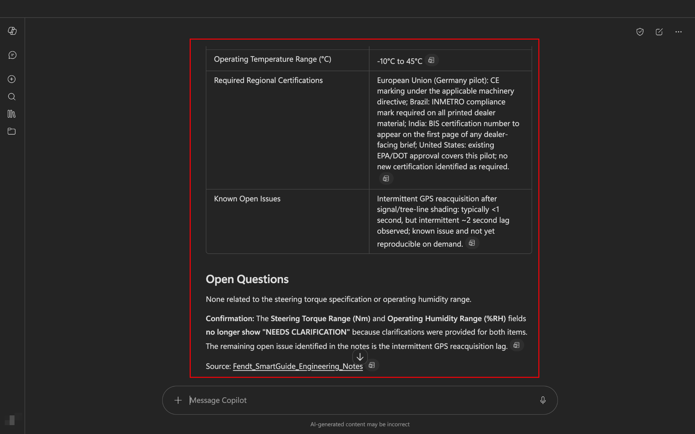

